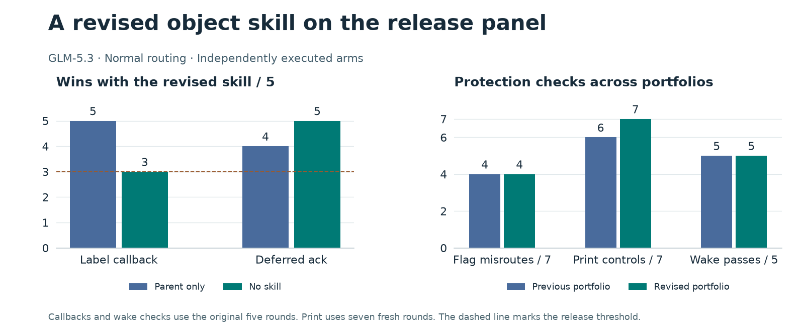
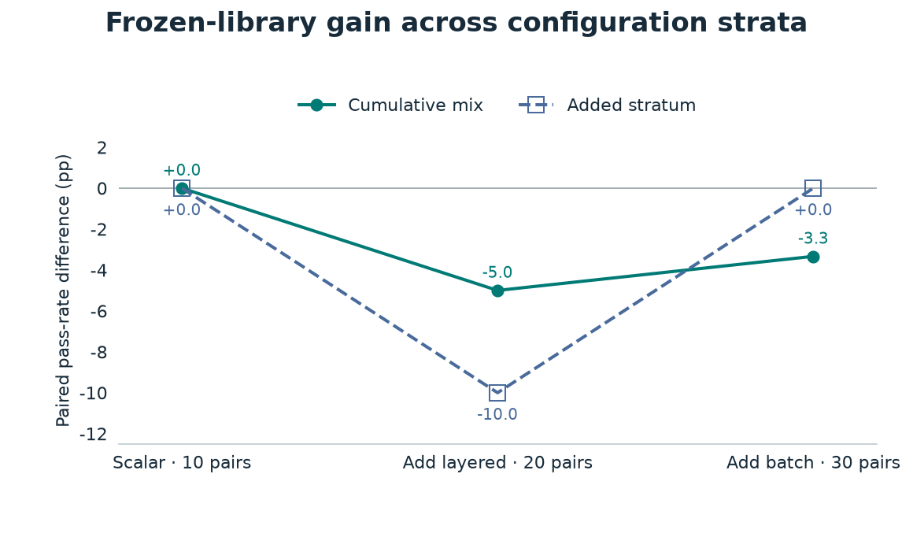
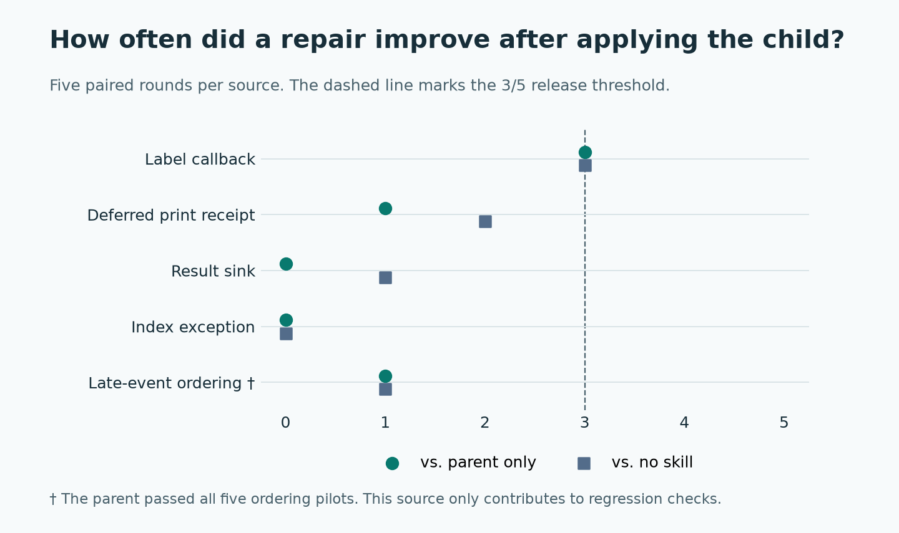
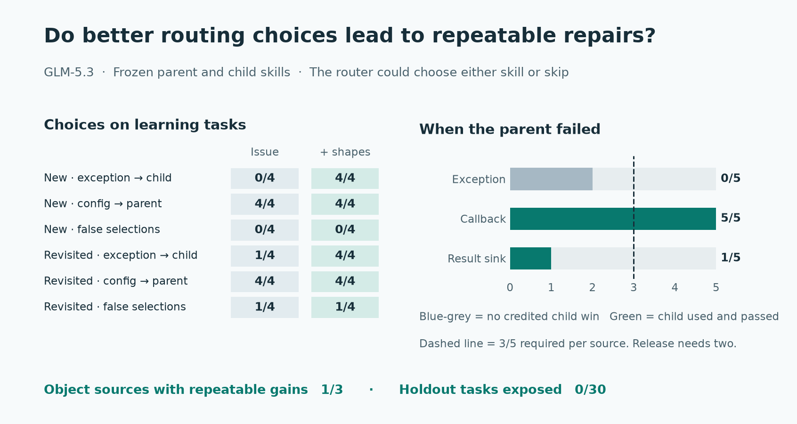
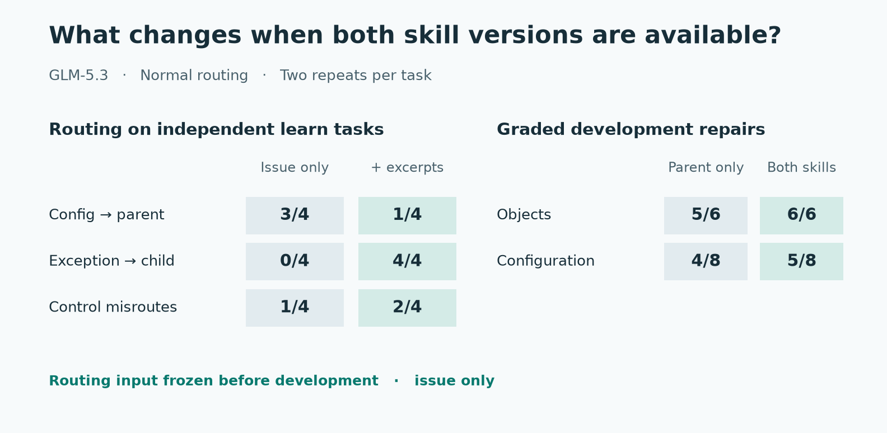
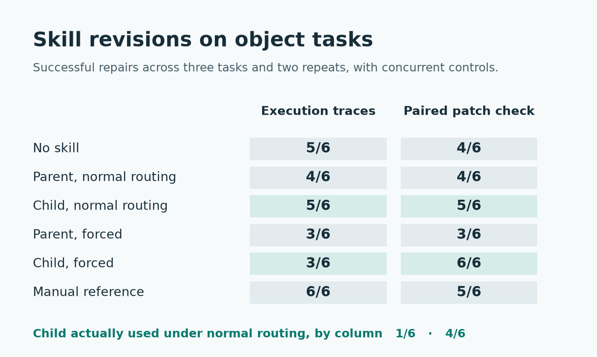
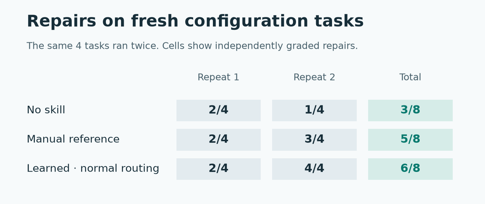
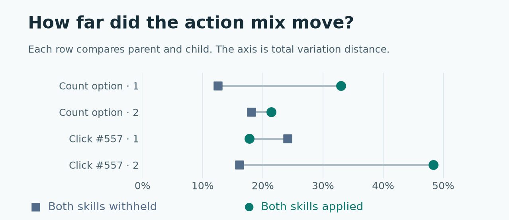

<h1 align="center">EvoCoder</h1>
<p align="center"><a href="README.md" lang="zh-CN">简体中文</a> · <strong>English</strong></p>
<p align="center">
  <a href="LICENSE"></a>
  <a href="pyproject.toml"></a>
  <a href="https://github.com/Phoenix-chaser/EvoCoder/actions/workflows/checks.yml"></a>
  <a href="docs/results/overview.json"></a>
  <a href="src/evocoder/sandbox.py"></a>
  <a href="Makefile"></a>
</p>

EvoCoder tests whether **a coding agent can learn a method from past repairs that helps on the next task**. The model edits Python code, runs tests in an isolated repository and writes a versioned skill from its execution traces. On later tasks it can use or skip that skill. A failed application gives the model evidence to revise when the skill applies, what to do and how to check the fix. EvoCoder keeps the requested model version fixed and does not update its weights.

[Where does self-evolution show up?](#where-does-self-evolution-show-up) · [Earlier experiments](#earlier-experiments) · [Quick start](#quick-start) · [Bring your own tasks](#bring-your-own-tasks)

## Where does self-evolution show up?

### Which repairs improved after revising the object skill?

Using live GLM-5.3 on four purpose-built Python learning programs, the old library selected its object skill on all eight scalar-flag trials. A mixer patch passed the public test but eagerly acquired the default device on wake. GLM revised scope and recovery steps from execution records. An alternative given explicit role labels reduced flag misroutes from 4/4 to 1/4 in matched learning trials, while wake repairs fell from 3/4 to 2/4. The first revision therefore entered the release panel alongside the original configuration skill.

| Callback source, five fresh rounds | No skill | Configuration parent only | Previous portfolio | Revised portfolio | Attributable wins over parent / no skill |
| --- | ---: | ---: | ---: | ---: | ---: |
| Original label callback | 2/5 | 0/5 | 5/5 | 5/5 | **5/5 · 3/5** |
| Replication watermark and deferred acknowledgement | 0/5 | 1/5 | 4/5 | 5/5 | **4/5 · 5/5** |

On each of two independently implemented checkpoint callbacks, 3/5 parent pilot submissions passed public tests and ordinary controls while still missing a callback boundary. All comparisons in the table used fresh runs. Relative to the previous portfolio, the revision added one watermark repair and tied on the label callback. [Study and learning patch examples (中文)](docs/workflow-revision-study.md) · [Original trials and first rejecting receipt](docs/results/workflow-revision.json)

**This GLM experiment recorded its first live library activation.** A TLS outage left nine configuration grades missing in the first evaluation. An independent release confirmation retained the completed object and ancestry evidence and collected all seven configuration rounds again with 112 fresh solves. The previous and revised portfolios passed 6/7 and 7/7 print-configuration trials, respectively. Both selected the object skill incorrectly on 4/7 and passed the scheduler wake check on 5/5. The evaluator issued a passing receipt and SQLite recorded release transaction 1. [Confirmation protocol](benchmarks/falsy_transfer/workflow-confirmation.json) · [Passing receipt, activation and holdout outcomes](docs/results/workflow-confirmation.json)



### Did the released library help on 30 unseen tasks?

Unassisted GLM passed **30/30** and the released library passed **29/30**. The frozen sequence started with 10 scalar configuration tasks, then added 10 layered tasks and 10 batch tasks. The cumulative pass-rate differences were **0, −5.0 and −3.3 percentage points**. Each arm ran once per task, with all 60 solves graded. The library selected the configuration parent on all 30. This holdout measures configuration transfer. The paired comparison between the two portfolios above measures the incremental change on callbacks. [Task pairs, observed routes and curve data](docs/results/workflow-confirmation.json)

The only disagreement concerned layered renderer settings. The tenant disabled pagination with `False`, and a request-level `None` should inherit that value. The unassisted patch returned `False`. The patch produced with the parent skill returned the global default, `True`. The unassisted arm left no failed holdout tasks for the library to recover. [Failure analysis and scope (中文)](docs/workflow-revision-study.md#发布后的-30-道留出题)



### Did the caller-object skill transfer to a new deferred callback?

In 4/5 pilot runs the parent passed the public tests but broke deferred delivery. It solved all five ordering pilots. Development used separate print-queue and event-ordering programs. On each portfolio run GLM could select the configuration parent, the caller-object child previously revised from execution failures, or neither.

| Development task, five rounds | Attributed child wins vs. parent | Attributed child wins vs. no skill |
| --- | ---: | ---: |
| Original label callback | 3/5 | 3/5 |
| New deferred print receipt | 1/5 | 2/5 |

Across 25 object solves per arm, the portfolio passed **24/25**, the parent **19/25**, and no skill **16/25**. Each comparison required two sources with at least 3/5 attributable wins. Only the **original label callback** qualified against either baseline. The evaluator recorded a rejection. Holdout exposure was **0/30**. The seven configuration rounds also identified one new loss after the child was selected for a print-profile issue. The preregistered rule separately accounted for variation after identical first requests. [Preregistration](benchmarks/falsy_transfer/callback-release.json) · [Study report (中文)](docs/callback-release-study.md) · [Paired outcomes and receipt](docs/results/callback-release.json)



All 159 development solves were graded. Of 72 support solves, 71 had grades. The receipt records the HTTP 500 as a missing result.

### Which repairs improved in the earlier public-test-shape study?

GLM-5.3 could select the configuration parent, the caller-object child previously revised from failed repairs, or neither. We froze both skills and added public test filenames, call arguments and assertion shapes to the router input. **On six new learning tasks, exception-to-child choices rose from 0/4 to 4/4, config-to-parent choices stayed at 4/4, and control misroutes stayed at 0/4.** On six revisited tasks, exception-to-child choices rose from 1/4 to 4/4. Each cell covers two tasks routed twice. All eight structured exception choices cited a truthiness method declared in a public test fixture. None of these fixtures was directly constructed by its public assertions. [Design, task definitions and model quotations (中文)](docs/shape-routing-study.md)

| Development repairs over five repeats | No skill | Parent only | Both skills, issue only | Both skills, with shapes |
| --- | ---: | ---: | ---: | ---: |
| Caller objects, 3 tasks | 8/15 | 7/15 | 8/15 | 12/15 |
| Configuration, 4 tasks | 9/20 | 18/20 | 15/20 | 11/20 |



**The child recovered a parent failure in 5/5 callback pairs, 1/5 result-sink pairs and 0/5 exception pairs.** **1/3** object sources cleared the preregistered 3/5 threshold. Release requires two. Holding the skill library fixed, object repairs rose from 8/15 to 12/15. Only one of those four extra passes involved a different skill choice. The structured portfolio selected the parent on 17/20 configuration runs. Even among configuration pairs with identical first solver requests, it recorded 0 wins and 7 losses against the parent arm. The release gate rejected the library. Holdout exposure was **0/30**. [Paired runs, independent patch grades and release receipt](docs/results/shape-routing.json)

All 140 preregistered development solves completed. Of 72 original support solves, 69 could be graded. Three additional runs are reported separately, with the original outcomes marked missing. [Support replay and accounting (中文)](docs/shape-routing-study.md#支持回放发布与账目)

### How did the portfolio perform in the earlier two-repeat study?

GLM could select the original configuration skill, the learned caller-object skill, or neither. **With both available, it selected the parent on all eight configuration trials and the child on all four label-callback and result-sink trials.** It skipped both skills on both exception trials. The left panel shows routing on six independent learn tasks. The right panel shows independently graded development repairs. [Preregistered experiment and full report (中文)](docs/parallel-routing-study.md)



On the object panel the concurrent parent-only arm repaired **5/6** and the portfolio **6/6**. The portfolio gained one label-callback repair on the first repeat. Both arms passed on the second. Configuration repairs went from **4/8 to 5/8**, with two paired gains and one loss. In all three pairs the solver received the same parent skill and an identical first request. **Zero** independent object sources improved on both repeats. Release requires **two**. The 30 holdout tasks stayed sealed during that study. [Per-trial routes, patch checks and release decision](docs/results/parallel-routing.json)

### How did a real failed repair change the skill's scope?

GLM-5.3 applied the same parent skill twice to the same learning task. Both submitted patches passed the supplied public test. One discarded the caller's borrowed lease when redelivering a deferred notification. GLM wrote a new assertion that checked whether redelivery re-entered the original lease and whether the service opened an extra one. The assertion failed on the incomplete repair and passed on the other submitted patch and the independent reference. The public bundle includes both learning patches and the executable check. [Check, patches and outcomes](docs/results/object-witness.json)

With execution traces and test receipts, GLM produced a child that added a check for other entry points but excluded resource managers. Given the matched repairs, the new check's observed outcomes and other learning examples, GLM generated a second child from the same parent. Its applicability explicitly covers caller-supplied clocks, journals and resource managers. Its steps follow the same object through retries and acquire a default only when needed. Each child faced concurrent unassisted, parent and manual controls. [Study design and results (中文)](docs/object-revision-study.md)

**Forced application of the second child repaired all six object trials, 3/3 in each repeat. Its concurrent forced parent repaired 3/6 and the manual reference repaired 5/6.** Under normal routing the child was used in 4/6 trials and repaired 5/6. The parent was used in 0/6 and repaired 4/6. The child repaired the label callback in both repeats where the parent failed. On exception objects the router withheld the child twice, with a regression in repeat two. **One** object source delivered repeated gains against the **two** required for release. [Routes, forced interventions and release decision](docs/results/object-witness.json)



On the original configuration tasks, the concurrent parent was used in 8/8 trials and repaired 6/8. The second child was used in 0/8 and repaired 3/8. The release decision retained both the callback gains and the configuration regressions. Both children stayed unpublished and all 30 holdout tasks remained sealed. That study did not measure gain versus diversity. [Release and holdout records (中文)](docs/object-revision-study.md)

### What did the learned skill fix on new configuration tasks?

**Across four fresh configuration applications and two paired attempts per application, GLM-5.3 repaired 3/8 without a skill, 5/8 with a manual reference and 6/8 with its own learned skill.** It selected the learned skill in all eight trials. In the three additional repairs, the submitted patches preserved a zero sampling interval, a blank CSV caption and an empty palette. The reference skill corrected the same boundary on two of those paired trials. [Per-task routes and independent patch checks](docs/results/falsy-transfer.json)



An independent pretest first established that the manual procedure could correct a repeatable error. On a historical more-itertools defect, all three unassisted patches passed the public test and discarded the caller's falsy exception object on empty input. The reference skill preserved the object and passed the full task twice. All three additional configuration repairs shown above came in the second repeat. **Zero** development groups delivered the repeated wins required for release in this first panel. [Pretest, release rules and reproduction (中文)](docs/falsy-transfer-study.md)

Transfer to **caller-owned objects** produced different results. Across three fresh tasks and two repeats, the unassisted model repaired **5/6**, the manual reference **6/6**, normal routing with the learned skill available **3/6**, and forced injection of that same skill **2/6**. Normal routing injected the skill **0/6** times. All six first solver requests matched the unassisted inputs. The combined release gate rejected the candidate. In that study the model saw **zero of the 30 holdout tasks**. [Object-task routes, patch checks and combined gate](docs/results/falsy-objects.json)

### How did the model form the skill?

In the original 50-case study, GLM-5.3 learned from four unassisted repair traces to use the default for missing or `None` settings and preserve explicit values such as `0`, `False` and the empty string. It selected that skill on all six subsequent learning cases and passed all six. No qualifying failure triggered a child revision. The original development comparison produced zero additional repairs. [Model-authored skill and per-task outcomes](docs/results/optional-control.json)

| Live development comparison | No skill | Learned skill |
| --- | ---: | ---: |
| Passed independent grading | 10/10 | 10/10 |
| Submitted patch passed both missing-value and valid-falsy probes | 10/10 | 10/10 |
| Model calls, including routing | 55 | 73 |

Ten adapter implementations and five configuration types produced **50 executable cases**. Whole implementations were assigned to learning (10 cases), development (10) or holdout (30). The independent grader caught the repair that defaults all falsy values on all 50 cases. An evaluator-written reference skill repaired both prespecified development anchors, as did the unassisted model. With a perfect development baseline, neither group could deliver the repeated wins required for release. The model saw **zero holdout tasks** during that study. [Frozen protocol](benchmarks/optional_control/protocol.json) · [Methods and reproduction commands (中文)](docs/optional-control-study.md)

**Earlier Click trials show a change in how the agent used its tools.** We analyzed 32 archived live-model traces with zero new model calls. The figure uses the two tasks and two repeats with matched controls. Each point measures the distance between the parent and child distributions of actions such as reading, searching, editing and testing. Squares show the variation when both runs skipped the skill. Circles show it when both runs used their assigned version.



The behavior-change measure counts pairs where the distance with skills exceeds the matched skip control. **3/4** pairs met that criterion, with a mean excess distance of **12.4 percentage points**. With both skills applied, each version repaired **2/4**. This small sample shows a shift in the action mix and leaves its effect on individual repairs unresolved. Run `uv run --locked python scripts/report_optional_control.py verify` from the repository root to recompute the results without credentials. [Paired action counts](docs/results/behavior-uptake.json)

## Earlier experiments

### Can the offline demo revise and reuse a skill?

In this `make demo` run, the scripted Mock model produced a parent skill, then revised it after a later learning task failed. Both versions attempted the same four synthetic development tasks in Docker. Each circle represents one independently graded repair.


The revision fixed two additional tasks and preserved both earlier successes. After the support replay passed, the system published the revised skill, froze it and used it to repair **4/4 synthetic holdout tasks**. This run exercises the engineering workflow from execution feedback through revision, release and reuse. [Run data](docs/results/overview.json)

### The live model caught one more regression. Repair counts were tied.

GLM-5.3 ran two paired trials on each of two development tasks. Both versions received the same coverage feedback and a 16-step budget. The agent could skip the skill and chose to use it in all eight development runs. Each bar counts outcomes across four runs.


A detection counted only when the agent’s own assertion passed on both the submitted patch and the upstream fix, then failed on a version deliberately broken with the feature switched off. The revision produced one more such check. Both versions passed independent repair tests **3/4** times. **Zero** development groups produced repeatable repair gains against the **two** required for release, so the candidate stayed unpublished and the holdout stayed sealed. [Study methods (中文)](docs/click-switch-feedback.md) · [Per-run report (中文)](docs/reports/click-switch-feedback.html)

## Quick start

From the repository root, use Python 3.12, uv and a running Docker daemon. The offline demo runs on CPU and needs no model credentials.

```bash
make install
docker pull python:3.12-slim
make doctor
make demo
```

Each run creates a new `experiments/demo-*/` directory. Open `report.html` for the per-task comparison, `summary.json` for the evaluation receipt and published version, and `traces/` for the tool calls. Run `make test` for the non-Docker suite and `make integration` for the Docker integration tests.

<details>
<summary>Run the learning stream, inspect a version and roll it back</summary>

Generate fixtures, then run a stream with at most three proposals. The final test uses a frozen version.

```bash
uv run --locked evocoder --mode mock fixtures --output experiments/fixtures
uv run --locked evocoder --mode mock --state experiments/stream-01/state stream \
  --manifest experiments/fixtures/manifest.json \
  --output experiments/stream-01/report --max-proposals 3 --with-final-test
```

To run the stages separately, start with a new state directory and replace the uppercase IDs with values printed by earlier commands. A failed parent trial exits with status 1 and still emits the run ID needed for revision.

```bash
evoc() { uv run --locked evocoder --mode mock --state experiments/manual/state "$@"; }
evoc run experiments/fixtures/learn-01.json --no-skill
evoc propose --runs INITIAL_RUN_ID
evoc run experiments/fixtures/learn-02.json --skill V1_ID --candidate
evoc propose --runs INITIAL_RUN_ID FAILURE_RUN_ID --parent V1_ID
evoc evaluate V2_ID --manifest experiments/fixtures/manifest.json
evoc activate V2_ID --receipt EVALUATION_RECEIPT --expected none
evoc run experiments/fixtures/test-01.json
evoc inspect RUN_ID
evoc rollback --to none --expected V2_ID
```

Publishing requires a passing evaluation receipt. The `--expected` argument checks the current version to protect concurrent updates. [Versioning and rollback (中文)](docs/skill-library.md)

</details>

## Bring your own tasks

| Goal | Entry point |
| --- | --- |
| Import a Python repository | Use `evocoder pack` for a local snapshot or `realworld-prepare` for a pinned upstream commit. Each task specifies a public reproduction and independent grading tests. [Task format (中文)](docs/task-format.md) · [Preparing repositories (中文)](docs/realworld.md) |
| Connect a live model | Copy `.env.example` to a local `.env`, configure a Chat Completions-compatible endpoint, model, key and budget, then select `--mode live`. [Model configuration (中文)](docs/operations.md) · [GLM Coding Plan (中文)](docs/glm-coding-plan.md) |
| Inspect learning and release decisions | [Agent loop](src/evocoder/runtime.py) · [Feedback and revision](src/evocoder/evolution.py) · [Release decision](src/evocoder/gate.py) · [Skill library design (中文)](docs/skill-library.md) |
| Verify the evaluation and figures | [Protocol for 80 historical defects (中文)](docs/comparison-protocol.md) · [Chart data](docs/results/overview.json) · [Plotting script](docs/results/plot.py) |
