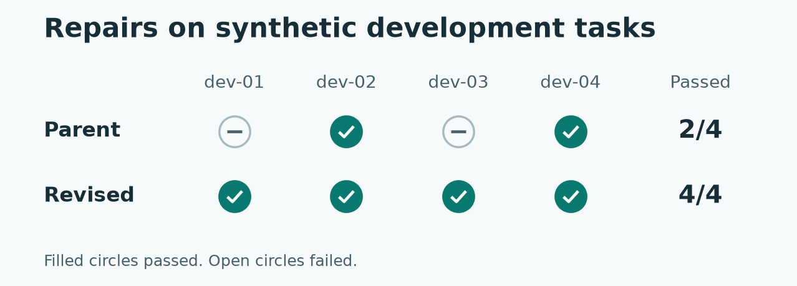
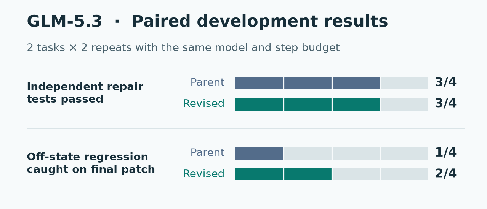

<h1 align="center">EvoCoder</h1>
<p align="center"><a href="README.md" lang="zh-CN">简体中文</a> · <strong>English</strong></p>
<p align="center">
  <a href="pyproject.toml"></a>
  <a href="https://github.com/Phoenix-chaser/EvoCoder/actions/workflows/checks.yml"></a>
  <a href="docs/results/overview.json"></a>
  <a href="src/evocoder/sandbox.py"></a>
  <a href="Makefile"></a>
</p>

EvoCoder tests whether **a coding agent can turn a failed repair into a method that helps on the next task**. The agent edits Python code and runs tests in an isolated repository. The model uses that feedback to revise a skill’s applicability conditions, diagnostic steps and checks. The evaluator runs the parent and revised skills on identical source snapshots before deciding whether to publish the revision. Model weights stay fixed throughout.

[Results](#results) · [Quick start](#quick-start) · [Bring your own tasks](#bring-your-own-tasks)

## Results

### Can the offline demo revise and reuse a skill?

In this `make demo` run, the scripted Mock model produced a parent skill, then revised it after a later learning task failed. Both versions attempted the same four synthetic development tasks in Docker. Each circle represents one independently graded repair.



The revision fixed two additional tasks and preserved both earlier successes. After the support replay passed, the system published the revised skill, froze it and used it to repair **4/4 synthetic holdout tasks**. This run exercises the engineering workflow from execution feedback through revision, release and reuse. [Run data](docs/results/overview.json)

### The live model caught one more regression. Repair counts were tied.

GLM-5.3 ran two paired trials on each of two development tasks. Both versions received the same coverage feedback and a 16-step budget. The agent could skip the skill and chose to use it in all eight development runs. Each bar counts outcomes across four runs.



A detection counted only when the agent’s own assertion passed on both the submitted patch and the upstream fix, then failed on a version deliberately broken with the feature switched off. The revision produced one more such check. Both versions passed independent repair tests **3/4** times. **Zero** development groups produced repeatable repair gains against the **two** required for release, so the candidate stayed unpublished and the holdout stayed sealed. [Study methods (中文)](docs/click-switch-feedback.md) · [Per-run report (中文)](docs/reports/click-switch-feedback.html)

## Quick start

From the repository root, use Python 3.12, uv and a running Docker daemon. The offline demo runs on CPU and needs no model credentials.

```bash
make install
docker pull python:3.12-slim
make doctor
make demo
```

Each run creates a new `experiments/demo-*/` directory. Open `report.html` for the per-task comparison, `summary.json` for the evaluation receipt and published version, and `traces/` for the tool calls. Run `make test` for the non-Docker suite and `make integration` for the Docker integration tests.

<details>
<summary>Run the learning stream, inspect a version and roll it back</summary>

Generate fixtures, then run a stream with at most three proposals. The final test uses a frozen version.

```bash
uv run --locked evocoder --mode mock fixtures --output experiments/fixtures
uv run --locked evocoder --mode mock --state experiments/stream-01/state stream \
  --manifest experiments/fixtures/manifest.json \
  --output experiments/stream-01/report --max-proposals 3 --with-final-test
```

To run the stages separately, start with a new state directory and replace the uppercase IDs with values printed by earlier commands. A failed parent trial exits with status 1 and still emits the run ID needed for revision.

```bash
evoc() { uv run --locked evocoder --mode mock --state experiments/manual/state "$@"; }
evoc run experiments/fixtures/learn-01.json --no-skill
evoc propose --runs INITIAL_RUN_ID
evoc run experiments/fixtures/learn-02.json --skill V1_ID --candidate
evoc propose --runs INITIAL_RUN_ID FAILURE_RUN_ID --parent V1_ID
evoc evaluate V2_ID --manifest experiments/fixtures/manifest.json
evoc activate V2_ID --receipt EVALUATION_RECEIPT --expected none
evoc run experiments/fixtures/test-01.json
evoc inspect RUN_ID
evoc rollback --to none --expected V2_ID
```

Publishing requires a passing evaluation receipt. The `--expected` argument checks the current version to protect concurrent updates. [Versioning and rollback (中文)](docs/skill-library.md)

</details>

## Bring your own tasks

| Goal | Entry point |
| --- | --- |
| Import a Python repository | Use `evocoder pack` for a local snapshot or `realworld-prepare` for a pinned upstream commit. Each task specifies a public reproduction and independent grading tests. [Task format (中文)](docs/task-format.md) · [Preparing repositories (中文)](docs/realworld.md) |
| Connect a live model | Copy `.env.example` to a local `.env`, configure a Chat Completions-compatible endpoint, model, key and budget, then select `--mode live`. [Model configuration (中文)](docs/operations.md) · [GLM Coding Plan (中文)](docs/glm-coding-plan.md) |
| Inspect learning and release decisions | [Agent loop](src/evocoder/runtime.py) · [Feedback and revision](src/evocoder/evolution.py) · [Release decision](src/evocoder/gate.py) · [Skill library design (中文)](docs/skill-library.md) |
| Verify the evaluation and figures | [Protocol for 80 historical defects (中文)](docs/comparison-protocol.md) · [Chart data](docs/results/overview.json) · [Plotting script](docs/results/plot.py) |
