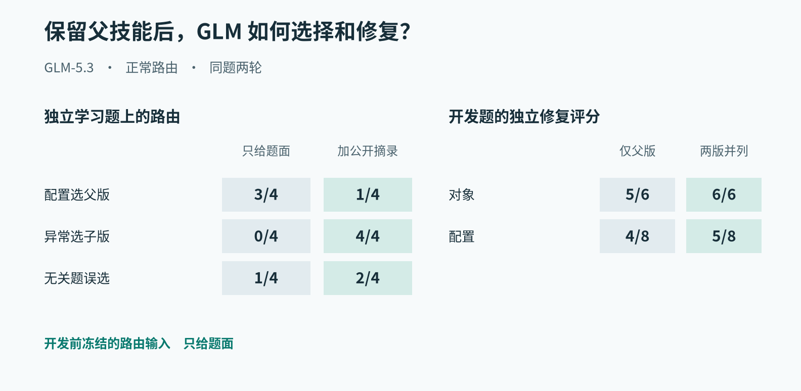
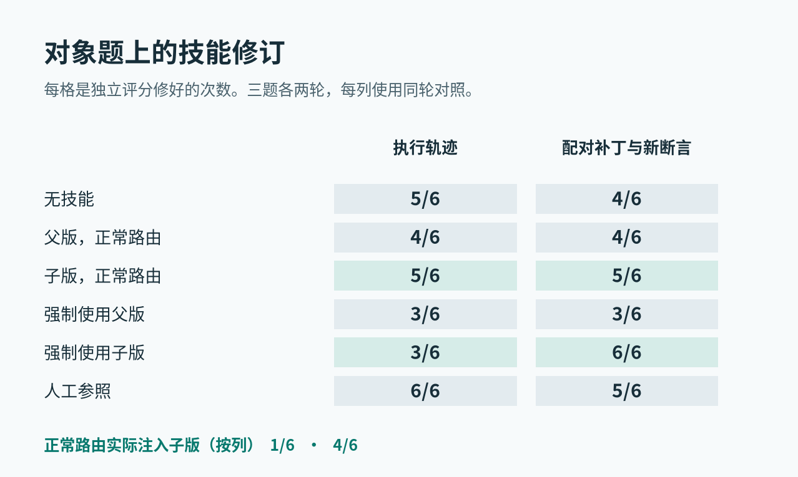
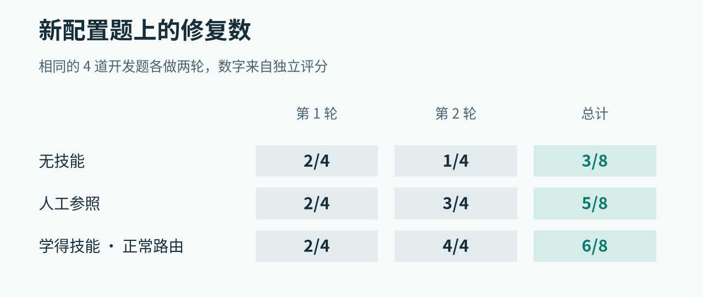
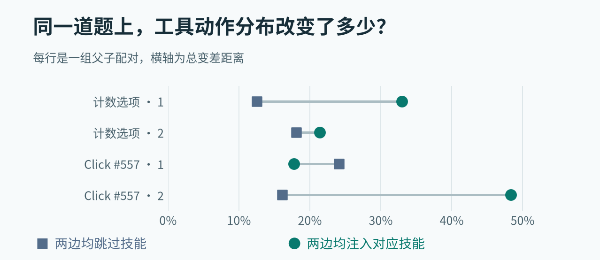
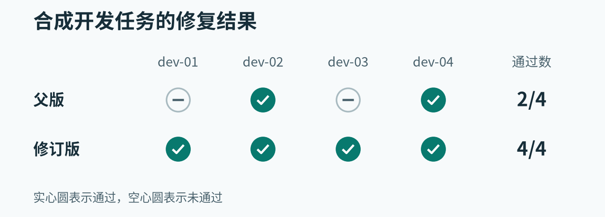

<h1 align="center">EvoCoder</h1>
<p align="center"><strong>简体中文</strong> · <a href="README.en.md" lang="en">English</a></p>
<p align="center">
  <a href="LICENSE"></a>
  <a href="pyproject.toml"></a>
  <a href="https://github.com/Phoenix-chaser/EvoCoder/actions/workflows/checks.yml"></a>
  <a href="docs/results/overview.json"></a>
  <a href="src/evocoder/sandbox.py"></a>
  <a href="Makefile"></a>
</p>

EvoCoder 检验 **Coding Agent 能否从过去的修复中学到对下一道题有用的方法**。模型在隔离的 Python 仓库里改代码、跑测试，从执行轨迹中写出带版本的技能。后续任务可以选用或跳过技能。实际使用后出现失败，模型才有证据修订它的适用条件、操作步骤和检查方法。实验固定请求的模型版本，项目不更新模型权重。

[自进化效果在哪里](#自进化效果在哪里) · [其他实验结果](#其他实验结果) · [快速运行](#快速运行) · [接入自己的任务](#接入自己的任务)

## 自进化效果在哪里

### 新的延迟回调能重复验证子技能的收益吗？

延迟回执预试中，父版 4/5 次通过公开测试后仍漏修队列恢复。排序策略预试中，父版 5/5 修对。开发使用独立的打印队列和事件排序程序。每次由 GLM 选择配置父技能、此前从执行失败中修订的对象子技能，或跳过。

| 开发对象，五轮 | 相对仅父版的子技能胜轮 | 相对无技能的子技能胜轮 |
| --- | ---: | ---: |
| 原标签回调 | 3/5 | 3/5 |
| 新的延迟打印回执 | 1/5 | 2/5 |

对象面板每组各运行 25 次，父子库修好 **24/25**、父版 **19/25**、无技能 **16/25**。发布要求两个独立来源都能在五轮中挽回至少三次基线失败。相对父版和无技能，达标的都只有**原标签回调**。评测器记录了拒绝收据，技能库未激活，留出题模型接触为 **0/30**。七轮配置中，打印配置题改选子技能后有一次新损失。历史相同首次请求的波动另按预登记的七轮规则处理。[注册协议](benchmarks/falsy_transfer/callback-release.json) · [实验方法](docs/callback-release-study.md) · [逐题成绩与收据](docs/results/callback-release.json)


所有 159 次开发求解均可评分。72 次支持回放中有 71 次可评分，HTTP 500 留下的缺口在收据中单列。

### 上一轮公开测试形状实验多修好了哪些缺陷？

GLM-5.3 可以选配置父技能、从真实失败中修订出的对象子技能，或跳过。本轮冻结两份技能，路由额外读取公开测试的文件名、调用参数和断言形状。**在六道新学习题上，异常对象选中子版由 0/4 提升到 4/4，配置选中父版保持 4/4，无关题误选保持 0/4。** 六道旧学习题的异常对象选择由 1/4 升到 4/4。每格来自两道题各两次路由。八次结构化异常选择都引用了公开测试文件中声明的真假值方法。这些替身在公开断言里均未直接构造。[任务、逐次引用与实验设计](docs/shape-routing-study.md)

| 五轮真实开发修复 | 无技能 | 仅父版 | 父子库，仅题面 | 同一父子库，加形状 |
| --- | ---: | ---: | ---: | ---: |
| 调用方对象，3 题 | 8/15 | 7/15 | 8/15 | 12/15 |
| 原配置，4 题 | 9/20 | 18/20 | 15/20 | 11/20 |


**标签回调有 5/5 轮由父版失败变为实际选用子版后整题通过，结果容器为 1/5，异常对象为 0/5。** 达到事前登记的 3/5 门槛的对象来源为 **1/3**，发布要求至少两个。固定同一父子库，对象总分从 8/15 提升到 12/15，四个新增成功中只有一个同时改变了技能选择。结构化并列组在配置题上 17/20 次选用父技能。和仅父版相比，相同首次求解请求的配置配对仍出现 0 胜、7 负。候选库未发布，留出题模型接触数为 **0/30**。[五轮配对、独立补丁评分与发布收据](docs/results/shape-routing.json)

五轮开发共 140 次求解，全部按原登记完成。72 次原始学习支持求解有 69 次可评分，三个中断缺口另做了三次补测，正式收据保留原始缺失。[支持回放与账目](docs/shape-routing-study.md#支持回放发布与账目)

### 前次两轮对照中，父子并列能保住配置能力吗？

我们把原配置父版和学得的对象子版放在同一个候选库，让 GLM 自己选一个版本或跳过。**并列组在配置题上 8/8 次选回父版，在标签回调和结果容器上 4/4 次选用子版。** 异常对象两次都跳过。图左比较六道独立学习题上的路由选择，图右是原开发面板上通过独立评分的修复数。[预登记、任务和实验报告](docs/parallel-routing-study.md)



对象题的同轮父版为 **5/6**，并列组为 **6/6**。标签回调首轮多修好一题，第二轮两组都通过。配置题为 **4/8 → 5/8**，其中两次改善、一次退化，三个配对都注入了同一父技能且首次求解请求相同。观察到的对象来源中，连续两轮改善的为 **0 个**，门禁要求至少 **2 个**。30 道留出题保持封存。[逐次路由、补丁边界检查与发布判定](docs/results/parallel-routing.json)

### 一次真实漏修如何改变了技能的适用范围？

同一个 GLM-5.3、同一个父技能，两次修复同一道学习题，交出了两个都能通过公开测试的补丁。其中一个在延迟重投通知时丢掉了调用方借出的租约对象。GLM 自己编写了一条新断言，检查重投是否再次进入原租约，以及服务是否额外打开了新租约。独立执行的结果是漏修补丁断言失败，另一个实际补丁和参考修复均通过。这段程序和两个学习补丁可以在本地重放。[断言、补丁与执行记录](docs/results/object-witness.json)

只给公开轨迹和测试收据时，GLM 修订出的第一个子版增加了检查其他入口的步骤，却把资源对象排除在外。再给同题的成功与失败补丁、新断言的执行结果和其他学习案例后，GLM 从原父版生成了另一个子版，主动把时钟、日志和资源管理器写进适用条件，并要求在重试等入口保留原对象、按需获取默认资源。两份子版的实际修复表现均用同轮无技能、父版和人工参照重新测量。[实验设计与逐题结果](docs/object-revision-study.md)

**在三道对象题各跑两轮，强制注入第二个子版修好 6/6，两轮各 3/3。同轮强制父版修好 3/6，人工参照 5/6。** 正常路由下，子版被选中 4/6 次，修好 5/6。父版被选中 0/6 次，修好 4/6。标签回调题连续两轮由父版失败变为子版通过。异常对象题上，子版两轮均未实际注入，第二轮退化。获得重复改善的对象来源为 **1 个**，发布要求至少 **2 个**。[正常路由、强制注入和发布判定](docs/results/object-witness.json)



在原配置题上，同轮父版被选用 8/8 次、修好 6/8，新子版被选用 0/8 次、修好 3/8。对象回调的收益和配置入口的退化同时保留在发布判定中。两个子版均未发布，原有 30 道留出题保持封存，收益随任务族多样性的曲线仍待测量。[正式门禁与留出记录](docs/object-revision-study.md)

### 学得的技能在新配置题上多修好了什么？

**在 4 个新配置程序、每题 2 轮的真实 GLM-5.3 对照中，无技能修好 3/8，人工参照技能修好 5/8，GLM 自己写出的技能修好 6/8。** 模型在 8 次求解中都选用了学得技能。相对无技能多修好的 3 个补丁分别保留了零采样间隔、空 CSV 标题和空调色板，独立断言在实际提交的补丁上都通过了。其中 2 个配对，人工技能也纠正了同一假值边界。[逐题补丁复验与路由记录](docs/results/falsy-transfer.json)



预试先检验人工技能能否纠正可重复的错误。在 more-itertools 的历史缺陷上，无技能模型连续 3 次通过公开测试，又连续 3 次在空输入上丢弃调用者传入的假值异常对象。人工参照技能有 2 次保留了该对象并通过整题。上图开发集的 3 个额外修复都出现在第二轮。获得两轮重复改善的开发组为 **0**，第一批开发对照未达到发布要求。[预试、门禁与复现方法](docs/falsy-transfer-study.md)

把相同规则迁移到**调用方提供的对象**时，三道新题各跑两轮。无技能修好 **5/6**，人工参照 **6/6**，正常路由下的学得技能组 **3/6**，强制注入同一技能 **2/6**。正常路由实际注入 **0/6**，六次首个求解请求均与对应的无技能组相同。候选未通过合并门禁，原有 **30 道留出题的模型接触数为 0**，收益随任务族多样性的变化仍待测量。[对象题的路由、补丁与合并门禁](docs/results/falsy-objects.json)

### 这条技能是怎么形成的？

在最初的 50 题配置实验中，GLM-5.3 从 4 条无技能修复轨迹归纳出缺省处理规则。输入缺失或为 `None` 时才回退到默认值，显式传入的 `0`、`False`、空字符串都要保留。后续 6 道学习题全部选中这条技能并通过，没有触发子版修订。首次开发对照的新增修复数为 0。[模型生成的技能与逐题结果](docs/results/optional-control.json)

| 真实模型开发对照 | 无技能 | 学得技能 |
| --- | ---: | ---: |
| 独立测试通过 | 10/10 | 10/10 |
| 提交补丁同时通过缺失值与合法假值复验 | 10/10 | 10/10 |
| 模型调用（含路由） | 55 | 73 |

我们用 10 个不同业务实现和 5 种配置类型生成了 **50 个可执行实例**，按完整实现分为学习 10、开发 10、留出 30。独立评分在 50 题上都能检出把合法假值误当缺失的补丁。人工编写的参照技能在两个预定开发实例上修好 2/2，无技能也是 2/2。开发基线已经满分，没有一个组出现候选独有的胜例。发布门禁要求两个开发组重复改善，因而 30 道留出题的模型运行数为 **0**，收益随任务族多样性变化的曲线仍待测量。[冻结协议](benchmarks/optional_control/protocol.json) · [实验方法与复现命令](docs/optional-control-study.md)

**历史 Click 实验中，使用不同技能版本时，部分工具的使用占比发生了变化。** 我们用 32 条已有真实轨迹做了零新增调用的诊断。下图取其中有匹配对照的两道题、各两轮，比较父版与子版的读、搜、改、测试等动作占比。方块是两次求解都跳过技能时的自然差异，圆点是它们各自使用对应版本时的差异。



以“注入技能后的距离超过同题同轮的跳过对照”为行为吸收指标，结果为 **3/4**，平均距离差为 **+12.4 个百分点**。固定注入时，父、子版各修好 **2/4**。动作变化可观察，这个小样本仍不足以判断技能内容导致了哪一次成败。在仓库根目录运行 `uv run --locked python scripts/report_optional_control.py verify`，无需密钥即可从公开记录复算。[逐配对动作计数](docs/results/behavior-uptake.json)

## 其他实验结果

### 离线演示能跑通技能修订和复用吗？

在这次 `make demo` 运行中，脚本化 Mock 模型生成了父技能，再根据后续学习任务的失败生成子版本。两版在 Docker 中分别修复同一组四道合成开发题，每个圆点对应一次独立评分。



修订版多修好两题，原先修好的两题继续通过。支持集回放也通过后，系统发布了修订版，再用冻结的版本修好 **4/4 道合成留出题**。这次运行验证了从执行反馈、技能修订、发布到新任务复用的工程流程。[运行数据](docs/results/overview.json)

### 真实模型多检出了一次回归，修复数持平

GLM-5.3 在两道开发题上各做两轮父子对照。两版使用相同的覆盖反馈和 16 步预算。运行时模型可以跳过技能，这八次开发求解都实际选中了对应版本。图中每条横条的分母都是四次求解。


“检出关闭回归”要求模型自己写的断言在提交的补丁和上游修复上都通过，在故意破坏功能关闭行为的版本上失败。修订版多了一次这样的有效检查，两版通过独立修复测试的次数均为 **3/4**。获得可重复修复改善的开发组为 **0**，发布要求至少 **2** 组，因此候选未发布，留出题保持封存。[实验方法](docs/click-switch-feedback.md) · [逐次结果](docs/reports/click-switch-feedback.html)

## 快速运行

准备 Python 3.12、uv 和运行中的 Docker，在仓库根目录执行以下命令。离线演示只用 CPU，无需模型密钥。

```bash
make install
docker pull python:3.12-slim
make doctor
make demo
```

每次演示会新建一个 `experiments/demo-*/` 目录。打开 `report.html` 看逐题对照，`summary.json` 包含评测收据和已发布版本，`traces/` 保留每次运行的工具调用。运行 `make test` 可执行非 Docker 测试，`make integration` 可执行 Docker 集成测试。

<details>
<summary>用 CLI 运行学习流、查看版本和回滚</summary>

生成任务后，以下命令会按顺序处理学习任务，最多提出三个候选，最后冻结版本运行测试集。

```bash
uv run --locked evocoder --mode mock fixtures --output experiments/fixtures
uv run --locked evocoder --mode mock --state experiments/stream-01/state stream \
  --manifest experiments/fixtures/manifest.json \
  --output experiments/stream-01/report --max-proposals 3 --with-final-test
```

也可以在新的状态目录中手动执行每一步。将大写 ID 替换为前面命令返回的值。父版在学习题上试用失败时返回 1，仍会输出用于修订的运行 ID。

```bash
evoc() { uv run --locked evocoder --mode mock --state experiments/manual/state "$@"; }
evoc run experiments/fixtures/learn-01.json --no-skill
evoc propose --runs INITIAL_RUN_ID
evoc run experiments/fixtures/learn-02.json --skill V1_ID --candidate
evoc propose --runs INITIAL_RUN_ID FAILURE_RUN_ID --parent V1_ID
evoc evaluate V2_ID --manifest experiments/fixtures/manifest.json
evoc activate V2_ID --receipt EVALUATION_RECEIPT --expected none
evoc run experiments/fixtures/test-01.json
evoc inspect RUN_ID
evoc rollback --to none --expected V2_ID
```

发布命令会校验评测收据。`--expected` 指定预期的当前版本，防止并发发布覆盖其他更新。[版本与回滚](docs/skill-library.md)

</details>

## 接入自己的任务

| 目标 | 入口 |
| --- | --- |
| 导入 Python 仓库 | 用 `evocoder pack` 导入本地快照，或用 `realworld-prepare` 固定上游提交。任务分别指定公开复现和独立评分测试。[任务格式](docs/task-format.md) · [仓库准备](docs/realworld.md) |
| 连接真实模型 | 复制 `.env.example` 为本地 `.env`，配置兼容 Chat Completions 的地址、模型、密钥和预算，再显式选择 `--mode live`。[模型配置](docs/operations.md) · [GLM Coding Plan](docs/glm-coding-plan.md) |
| 检查学习和发布机制 | [求解循环](src/evocoder/runtime.py) · [反馈与修订](src/evocoder/evolution.py) · [发布判定](src/evocoder/gate.py) · [技能库设计](docs/skill-library.md) |
| 复核评测和图表 | [80 个历史缺陷的评测协议](docs/comparison-protocol.md) · [图表数据](docs/results/overview.json) · [绘图脚本](docs/results/plot.py) |
