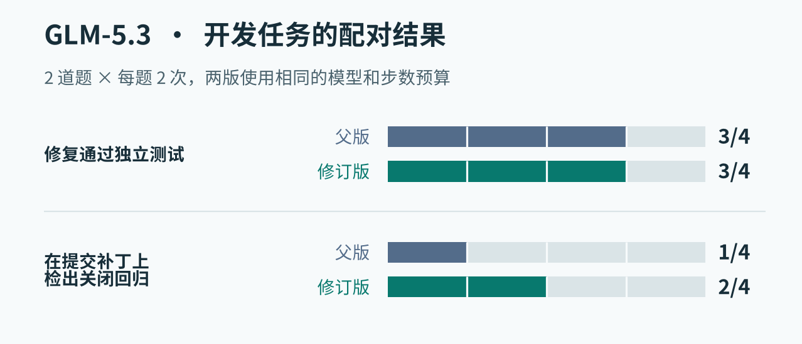

<h1 align="center">EvoCoder</h1>
<p align="center"><strong>简体中文</strong> · <a href="README.en.md" lang="en">English</a></p>
<p align="center">
  <a href="pyproject.toml"></a>
  <a href="https://github.com/Phoenix-chaser/EvoCoder/actions/workflows/checks.yml"></a>
  <a href="docs/results/overview.json"></a>
  <a href="src/evocoder/sandbox.py"></a>
  <a href="Makefile"></a>
</p>

EvoCoder 用来检验 **Coding Agent 能否从一次修复失败中学到对下一道题有用的方法**。Agent 在隔离的 Python 仓库里改代码、跑测试。模型根据执行反馈修订技能里的适用条件、排查步骤和验证方法。后续任务在同一份源码上分别试用父版和修订版，只有通过独立评测的候选才能发布。模型权重保持固定。

[实验结果](#实验结果) · [快速运行](#快速运行) · [接入自己的任务](#接入自己的任务)

## 实验结果

### 离线演示能跑通技能修订和复用吗？

在这次 `make demo` 运行中，脚本化 Mock 模型生成了父技能，再根据后续学习任务的失败生成子版本。两版在 Docker 中分别修复同一组四道合成开发题，每个圆点对应一次独立评分。


修订版多修好两题，原先修好的两题继续通过。支持集回放也通过后，系统发布了修订版，再用冻结的版本修好 **4/4 道合成留出题**。这次运行验证了从执行反馈、技能修订、发布到新任务复用的工程流程。[运行数据](docs/results/overview.json)

### 真实模型多检出了一次回归，修复数持平

GLM-5.3 在两道开发题上各做两轮父子对照。两版使用相同的覆盖反馈和 16 步预算。运行时模型可以跳过技能，这八次开发求解都实际选中了对应版本。图中每条横条的分母都是四次求解。



“检出关闭回归”要求模型自己写的断言在提交的补丁和上游修复上都通过，在故意破坏功能关闭行为的版本上失败。修订版多了一次这样的有效检查，两版通过独立修复测试的次数均为 **3/4**。获得可重复修复改善的开发组为 **0**，发布要求至少 **2** 组，因此候选未发布，留出题保持封存。[实验方法](docs/click-switch-feedback.md) · [逐次结果](docs/reports/click-switch-feedback.html)

## 快速运行

准备 Python 3.12、uv 和运行中的 Docker，在仓库根目录执行以下命令。离线演示只用 CPU，无需模型密钥。

```bash
make install
docker pull python:3.12-slim
make doctor
make demo
```

每次演示会新建一个 `experiments/demo-*/` 目录。打开 `report.html` 看逐题对照，`summary.json` 包含评测收据和已发布版本，`traces/` 保留每次运行的工具调用。运行 `make test` 可执行非 Docker 测试，`make integration` 可执行 Docker 集成测试。

<details>
<summary>用 CLI 运行学习流、查看版本和回滚</summary>

生成任务后，以下命令会按顺序处理学习任务，最多提出三个候选，最后冻结版本运行测试集。

```bash
uv run --locked evocoder --mode mock fixtures --output experiments/fixtures
uv run --locked evocoder --mode mock --state experiments/stream-01/state stream \
  --manifest experiments/fixtures/manifest.json \
  --output experiments/stream-01/report --max-proposals 3 --with-final-test
```

也可以在新的状态目录中手动执行每一步。将大写 ID 替换为前面命令返回的值。父版在学习题上试用失败时返回 1，仍会输出用于修订的运行 ID。

```bash
evoc() { uv run --locked evocoder --mode mock --state experiments/manual/state "$@"; }
evoc run experiments/fixtures/learn-01.json --no-skill
evoc propose --runs INITIAL_RUN_ID
evoc run experiments/fixtures/learn-02.json --skill V1_ID --candidate
evoc propose --runs INITIAL_RUN_ID FAILURE_RUN_ID --parent V1_ID
evoc evaluate V2_ID --manifest experiments/fixtures/manifest.json
evoc activate V2_ID --receipt EVALUATION_RECEIPT --expected none
evoc run experiments/fixtures/test-01.json
evoc inspect RUN_ID
evoc rollback --to none --expected V2_ID
```

发布命令会校验评测收据。`--expected` 指定预期的当前版本，防止并发发布覆盖其他更新。[版本与回滚](docs/skill-library.md)

</details>

## 接入自己的任务

| 目标 | 入口 |
| --- | --- |
| 导入 Python 仓库 | 用 `evocoder pack` 导入本地快照，或用 `realworld-prepare` 固定上游提交。任务分别指定公开复现和独立评分测试。[任务格式](docs/task-format.md) · [仓库准备](docs/realworld.md) |
| 连接真实模型 | 复制 `.env.example` 为本地 `.env`，配置兼容 Chat Completions 的地址、模型、密钥和预算，再显式选择 `--mode live`。[模型配置](docs/operations.md) · [GLM Coding Plan](docs/glm-coding-plan.md) |
| 检查学习和发布机制 | [求解循环](src/evocoder/runtime.py) · [反馈与修订](src/evocoder/evolution.py) · [发布判定](src/evocoder/gate.py) · [技能库设计](docs/skill-library.md) |
| 复核评测和图表 | [80 个历史缺陷的评测协议](docs/comparison-protocol.md) · [图表数据](docs/results/overview.json) · [绘图脚本](docs/results/plot.py) |
