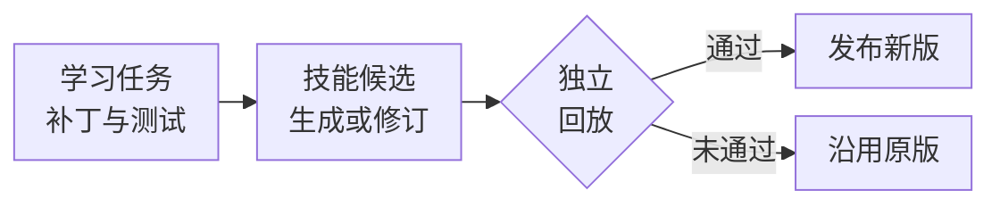
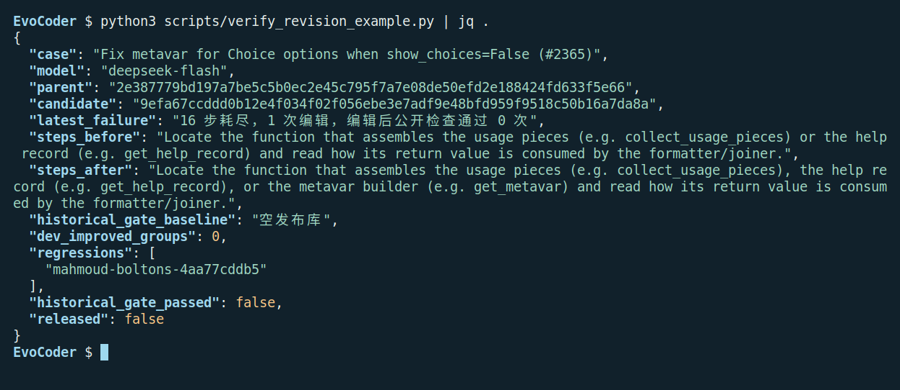
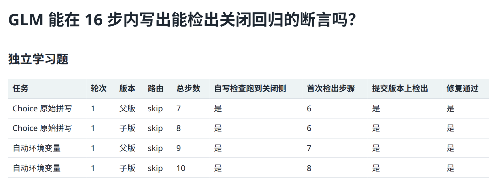

# EvoCoder

EvoCoder 是一套研究 **Coding Agent 如何从修复失败中学习** 的实验系统。Agent 在 Docker 中修改 Python 代码、运行测试。模型读取当次补丁和测试结果，修订技能里写下的适用条件、排查步骤和验证方法。独立任务检验新版本能否帮助后续修复，整个过程保持模型权重固定。

[运行离线演示](#在本机运行) · [查看真实模型结果](#glm-写的断言能检出什么) · [接入自己的仓库和模型](#接入自己的仓库和模型)



新任务到来时，模型先按问题描述选择技能，也可以跳过。只有学习任务实际采用了父版并留下符合修订条件的失败记录，系统才据此修改这个版本。每个子版保存父版本和证据的哈希，能追溯到当时的补丁和测试。[技能选择与修订规则](docs/skill-library.md)

## Click #2365 的一次真实修订

Click 的 `Choice(show_choices=False)` 在帮助文本里显示了错误的参数占位符。DeepSeek 选中了已有技能，做了一次源码编辑，用尽 16 步，编辑后没有一次公开检查通过。父技能建议从用法或帮助记录入手。子版还要求检查生成占位符的 `get_metavar`，并追踪格式化器如何使用它的返回值。[案例与原始证据](examples/README.md)

在仓库根目录运行这条命令，只需 Python 3 标准库。脚本校验父子版本的内容哈希，并从逐题结果重新计算发布决定。

```bash
python3 scripts/verify_revision_example.py
```



这次历史回放的对照是当时的空技能库。开发集改善了 **0 组**，出现 **1 条退化**，候选没有发布。样本里的父子技能可逐字段比较，评测收据保留了逐题结果。[样本 JSON](examples/click-revision.json)

## 在本机运行

准备好 Python 3.12、uv 和 Docker 后，在仓库根目录运行以下命令。

```bash
make install
docker pull python:3.12-slim
make doctor
make demo
```

`make demo` 使用脚本化的 Mock 模型，实际启动容器、修改源码并运行测试，无需 API 密钥。每次运行都会创建独立的 `experiments/demo-*/` 目录。打开其中的 **`report.html`** 查看技能差异和逐题对照，在 `summary.json` 里可以核对评测收据和最终发布的版本。离线单元测试用 `make test`，Docker 集成测试用 `make integration`。

<details>
<summary>用 CLI 单独运行学习、评测和回滚</summary>

生成任务后，可以直接跑一条自动学习流。这里显式选择 Mock，每轮最多提出三个候选，最后冻结版本运行测试集。

```bash
uv run --locked evocoder --mode mock fixtures --output experiments/fixtures
uv run --locked evocoder --mode mock --state experiments/stream-01/state stream \
  --manifest experiments/fixtures/manifest.json \
  --output experiments/stream-01/report --max-proposals 3 --with-final-test
```

要逐步查看父子版本，可在一个新的状态目录中分别执行以下命令，并把大写 ID 替换为之前命令的实际输出。父版试用失败时返回 1，仍会输出供下一次修订使用的运行 ID。

```bash
evoc() { uv run --locked evocoder --mode mock --state experiments/manual/state "$@"; }

evoc run experiments/fixtures/learn-01.json --no-skill
evoc propose --runs INITIAL_RUN_ID
evoc run experiments/fixtures/learn-02.json --skill V1_ID --candidate
evoc propose --runs INITIAL_RUN_ID FAILURE_RUN_ID --parent V1_ID
evoc evaluate V2_ID --manifest experiments/fixtures/manifest.json
evoc activate V2_ID --receipt EVALUATION_RECEIPT --expected none
evoc run experiments/fixtures/test-01.json
evoc inspect RUN_ID
evoc rollback --to none --expected V2_ID
```

评测未通过时，命令返回 1 并保存原因。发布需要通过收据，`--expected` 会核对当前版本以避免覆盖并发变更。已开始的任务继续使用启动时选定的版本。[多技能发布与回滚](docs/skill-library.md)

</details>

## GLM 写的断言能检出什么

两道新的 Click 学习题都只公开了功能开启的例子。GLM-5.3 在原有 16 步预算内可以自行调用 CLI、补写关闭场景的断言并执行。报告逐次记录模型何时首次写出有效断言，以及断言是否在最终提交的同一份补丁上跑过。



- **断言本身有效。** 在 Choice 父版的第 6 步，模型验证严格匹配会拒绝 `APPLE`、接受 `Apple`。同一脚本在当步补丁和上游修复上均退出 0，在刻意破坏严格匹配的版本上由模型写的第 11 行断言触发失败。[断言与补丁](examples/click-live-switch.json)
- **修复率收益尚未证实。** 四次学习求解都检出了关闭回归，路由却全部选择 `skip`，因此无法把结果归因到子版。这轮也没有同题关闭反馈的对照。随后的开发对照里，两版在计数选项题和 Click #557 上都实际使用了技能，各修好 **3/4**。没有开发组取得可重复的改善，候选未发布，两道留出题保持封存。[完整实验](docs/click-switch-feedback.md) · [可下载后打开的 HTML 报告](docs/reports/click-switch-feedback.html)

## 接入自己的仓库和模型

- **导入任务。** 用 `evocoder pack` 导入本地代码快照，或用 `realworld-prepare` 固定上游提交。任务指定可编辑文件、公开复现和独立评分测试，依赖预装在镜像内，求解容器关闭网络。[任务格式](docs/task-format.md) · [真实仓库准备流程](docs/realworld.md)
- **运行真实模型。** 将 `.env.example` 复制为本地 `.env`，配置兼容 Chat Completions 的地址、模型、密钥和预算，再显式选择 `--mode live`。费用记录在本地账本。[配置与运行示例](docs/operations.md) · [GLM Coding Plan](docs/glm-coding-plan.md)
- **评估能否发布。** 多技能库在相同源码、模型和步数下比较候选库与当前库。真实模式要求至少两个独立开发组各两次出现与技能使用变化相符的配对改善，且开发集和技能支持集均未观察到退化或执行错误。终评冻结技能库，测试结果只用于评分。[路由与发布规则](docs/skill-library.md) · [评测协议](docs/comparison-protocol.md)

## 实验与实现索引

| 想了解什么 | 从哪里看 |
| --- | --- |
| 修订摘要是否与当次补丁、测试一致 | [Click #3509 的证据校验](docs/click-revision-pilot.md) |
| 同题为何选中或跳过技能，修订后的步骤怎样回退 | [固定路由与正常路由对照](docs/click-routing-study.md) · [步骤修订与补丁回退](docs/click-procedure-study.md) · [关闭场景复验](docs/click-missing-state-study.md) |
| 历史基准有多大，能支持哪些结论 | [7 个仓库的 80 个缺陷及评测边界](docs/comparison-protocol.md) · [带上游定位线索的历史结果](docs/comparison-experiment-001.md) |
| 如何从执行反馈生成候选并作出发布决定 | [求解循环](src/evocoder/runtime.py) · [证据与技能修订](src/evocoder/evolution.py) · [多技能发布门禁](src/evocoder/gate.py) |
| 如何组织任务、隔离执行和保存版本 | [系统设计](docs/design.md) · [沙箱](src/evocoder/sandbox.py) · [状态存储](src/evocoder/store.py) · [验证记录](docs/verification.md) |
