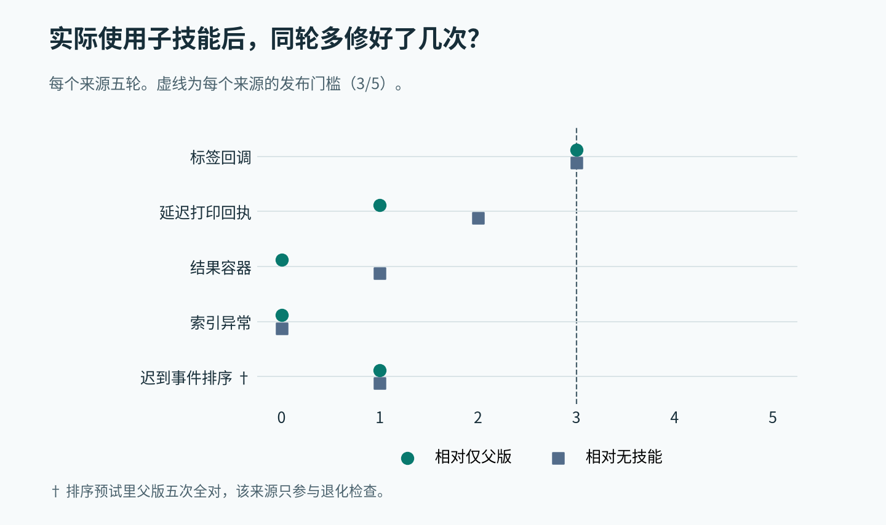

# 延迟回调能否提供第二个可重复改善的来源？

本轮检验已冻结的 GLM-5.3 技能库能否第一次在这条真实模型实验线上获得发布收据。父技能来自配置修复轨迹。模型后来依据学习任务中的失败补丁、成功补丁和执行过的断言，修订出了保留调用方对象的子技能。两版可以并存。正式比较中，模型自行决定使用父版、使用子版或跳过。上轮标签回调曾有 5/5 个父版失败被子版修好。这次从零重新计数。[技能的学习证据](object-revision-study.md) · [新调用前公开的协议和代码](https://github.com/Phoenix-chaser/EvoCoder/commit/0789db96fa0f7c12c2f8b63965a1c10f01d1462a)

## 两个新来源如何入选

每个来源有两个独立的 Python 程序。预试和正式程序的任务 ID、可编辑文件、类和 API 均不同。它们共享要检验的缺陷机制，因此同一来源的预试和正式程序合计只算一个来源。四个程序均为本研究构造。公开测试会实际调用传入的对象并检查身份。路由可以看到提取出的文件名、调用和断言形状。隐藏边界只在评分时执行。[可执行工作区及参考修复](../scripts/callback_sources.py)

| 来源 | 仅父版的预试 | 另一套正式程序 | 纳入发布收益计数 |
| --- | --- | --- | --- |
| 延迟回执 | 在离线仓库提交回执，或挂起后调用原记录器。第 1、2、3、5 轮各漏掉排队路径，公开测试和常规用例均通过。 | 打印业务生成票据，恢复后通知原订阅者。 | 是，4/5 次合格失败 |
| 调用方排序策略 | 自定义书架排序和跨抽屉归并。父版 5/5 修对。 | 回放计划加上迟到事件的有序插入。 | 仅参与退化保护，0/5 次合格失败 |

每个新程序都以三个补丁在 Docker 中校准。原始版本在公开复现上失败。只修首文件可以通过公开测试和常规输入，仍会在另一条路径丢掉合法假值对象。完整参考修复通过每个边界。校准提供这道题有能力区分什么行为的证据。表中的 4/5 来自模型真正提交的补丁。[预试定义和逐项校准](../benchmarks/falsy_transfer/callback-release.json)

## 为什么父版预试的四次漏修没有转成四次正式胜轮

在仓库回执预试程序里，记录对象进入排队路径时要被正确写入，确认时还要被正确取出。四次失败提交都通过公开测试和常规用例，又都漏掉了排队路径，其中一次同时漏掉了即时路径。在正式打印程序里，暂停时生成的票据把接收者放进列表，恢复时通知列表里的第一个对象。父版五次中有四次已经修好这项合同，另外一次在即时和恢复两处均失败。父子库五次都选中对象子技能，也五次修好，因此相对父版最多只能多修好 **1/5**。两个工作区在存取逻辑和测试替身上都有差别，这次没有单独改变其中一个因素来测其因果作用。[两套程序](../scripts/callback_sources.py) · [逐补丁边界评分](results/callback-release.json)

## 五轮门禁和七轮噪声保护

五个对象来源各跑五轮，四道原配置题各跑七轮，八道祖先学习支持题各回放三轮。每个任务、每个轮次使用三次独立求解，共计 231 次。无技能组有 15 个求解动作。仅父版组和结构化父子库组各有一次自选路由及 15 个求解动作。配对顺序在首次请求前锁定。每次都从同一冻结的代码快照开始。[求解顺序和运行入口](../scripts/run_callback_release.py)

一次归因胜轮要求基线失败、候选实际选择对象子技能、首个求解请求体改变，且候选补丁通过完整评分。父子库相对原父版和无技能两边都须各有两个来源达到 3/5，其中至少一个来自合格的新预试。已知开发题和单一程序的多次重复可以检验修复是否稳定，无法代表五个新项目。

历史配置面板有 20 对使用相同技能、相同首个求解请求的对照，其中 7 对最终成绩不同。按二项模型，分歧概率的单侧 95% 上界为 0.5580。若两边可交换，单向损失概率的上界为 0.2790。先给八个逐题比较合计分配 0.025 的尾概率，得到 **一题七轮中出现六次原始损失就拦截**。该上界下六次及以上损失的概率为 0.002513，每个比较的限额为 0.003125。同时将每轮四道配置题的原始净损失相加，对七个轮次的全部 128 种符号组合计算单侧尾概率。任一基线超过预登记的不利标准（净损失为正且概率 ≤ 0.0125），整个面板也会拦截。对所有对象、配置和支持任务还逐题检查首个求解请求改变时的净胜负，负轮多于胜轮即拦截。对象与支持任务另有原始多数负轮保护。[历史空对照](results/shape-routing.json) · [校准和判定实现](../scripts/callback_policy.py)

这些阈值依赖服务在两个实验期间足够稳定，以及零效应下符号可交换、轮次近似独立。历史样本只有 20 对，首个请求相同的两次运行从第二个动作起就可能分叉。这套规则预先说明了怎样处理这种波动，也保留了退化原始计数，不能保证未来发布永远不会误判。

## 打印配置题为何触发另一条保护

配置面板总分为无技能 11/28、父版 19/28、父子库 23/28。相对父版，相同首次求解请求有七胜两负。相对两种基线，七轮配置整体不利尾概率均为 1，逐题也没有出现六次原始负轮。

第四轮打印配置题则给出了不同的证据。仅父版组选择跳过，提交通过。父子库组选了对象子技能，路由理由引用公开形状 `assert Is: call:sides / bool`，把显式布尔选择视为合法假值覆盖。其补丁通过公开测试和本地、入队的单面打印边界，却未通过常规输入检查。七轮中，首次求解请求改变的配对在这道题上为零胜一负，触发预登记的逐题保护。公开断言里 `is False` 与 `is subscriber` 两者都能产生 `assert Is` 信号。路由记录给出了可用独立学习题再检验的区别。[逐次路由、引用与分项评分](results/callback-release.json)

## 发布与最终测量

通过两个基线的完整门禁，评测器才可写入通过收据，并在 SQLite 事务中把激活的技能库从空切换为冻结的父子库。留出组通过实际发布的库 ID 运行。共享账本登记首次模型接触。发布前后分别校验技能、发布记录和已见题目。30 道题按原先约定的顺序分成单值、多层和批处理，各十道。无技能和发布库每题各求解一次，共 60 次。图上的三个累计点分别用 10、20、30 对作分母，同时报告各新增族自身的修复率差，单位是百分点。三个累计点共用前面的样本。该题集覆盖配置程序，对象回调题上的效果需要单独解读。[冻结的 30 题和条件解封规则](../benchmarks/falsy_transfer/callback-release.json)

## 配对结果与收据

| 开发来源 | 无技能通过 | 仅父版通过 | 父子库通过 | 实际选子版 | 相对父版归因胜轮 | 相对无技能归因胜轮 |
| --- | ---: | ---: | ---: | ---: | ---: | ---: |
| 标签回调 | 2/5 | 2/5 | 5/5 | 5/5 | 3/5 | 3/5 |
| 延迟打印回执 | 3/5 | 4/5 | 5/5 | 5/5 | 1/5 | 2/5 |
| 结果容器 | 4/5 | 5/5 | 5/5 | 5/5 | 0/5 | 1/5 |
| 索引异常 | 3/5 | 4/5 | 4/5 | 0/5 | 0/5 | 0/5 |
| 迟到事件排序 | 4/5 | 4/5 | 5/5 | 5/5 | 1/5 | 1/5 |



| 面板 | 无技能 | 仅父版 | 父子库 |
| --- | ---: | ---: | ---: |
| 对象 | 16/25 | 19/25 | 24/25 |
| 配置 | 11/28 | 19/28 | 23/28 |
| 祖先支持 | 24/24 | 21/23 | 23/24 |

| 对照基线 | 达标对象来源数 | 触发逐题保护的任务 | 配置相同首请求胜／负 | 配置七轮整体不利尾概率 |
| --- | ---: | --- | ---: | ---: |
| 仅父版 | 1 | `transfer-print-ticket` | 7 / 2 | 1.000000 |
| 无技能 | 1 | `learn-scheduler-watch` | 0 / 0 | 1.000000 |

调度器支持题第三轮也触发了逐题保护。无技能组通过，父子库使用对象子技能后，在常规输入及唤醒后重新使用回调的边界上失败。其他两轮两边都通过。

本轮执行 241 次求解，账本核对了 2260 次模型调用。按本地套餐系数及供应商返回的用量折算 2,216.73279 积分，另有 27.14109 积分仍为本轮预留。导出时独立重跑 168 个不同的任务及补丁组合，另按冻结输入重建每个首个求解请求和路由请求。[机器可读收据](results/callback-release.json)

支持回放计划 72 次，有 71 次可评分。`export-04` 第一轮的仅父版请求收到 HTTP 500，缺少补丁和成绩。完整任务比较剔除了这一个支持任务，收据另外报告其可用配对。相对父版有 2/3 轮可比较，两组都通过这两轮。相对无技能有 3/3 轮可比较，两组全部通过。采集补充规则只允许完成原始槽位并签发拒绝收据。对象和配置面板原始运行均已完成，其证据已足以阻止发布。[中断后的采集登记](../benchmarks/falsy_transfer/callback-collection.json)

评测收据为 `81ce23e8eb692e5d269ddcf63ae44e98a5398b04564054ad0cb3ed5cfd5346b0`。本次数据库记录为拒绝，激活记录数为零。将这条真实收据交给数据库副本上的正式激活入口，入口也拒绝发布。共享账本和实验库都显示原 30 道留出题模型接触为零，多样性曲线待测。

## 复核

从仓库根目录运行以下命令。第一条使用公开结果、冻结的任务生成器和历史对照重算路由、成绩、每条门禁及账目，并在内存中重建路由请求和每次求解的首个请求。第二条在本机已有注册镜像时重新运行四个新程序的三种校准补丁。

```bash
uv run --locked python scripts/report_callback_release.py verify
uv run --locked python scripts/report_callback_release.py calibrate
```

本地原始 SQLite 档案还保存了模型选择、实际提交的补丁和测试事件。导出时逐个核查这些事件，在注册镜像中重新评分每个不同的「任务、补丁」组合。公开结果保留逐题哈希、路由引用、测试结论和本实验内的调用序号。凭据、账户账本和原始对话保存在本地。
