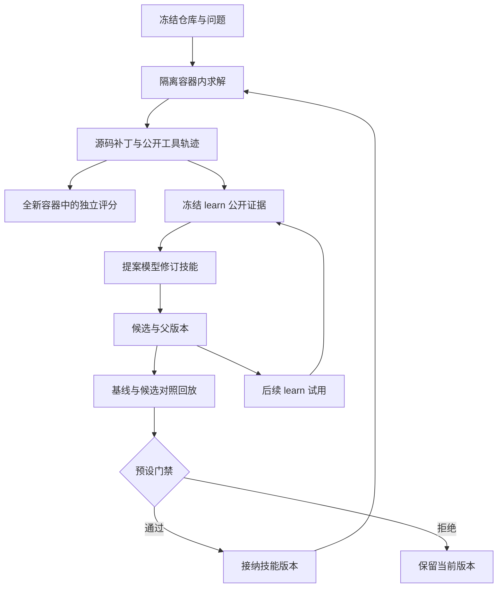

# 核心设计与评测边界

## 目标与研究假设

固定求解模型参数和基础工具，允许系统依据公开执行反馈修改可复用技能的内容与适用范围。待验证假设是：持续修订相比原始轨迹检索或冻结技能，更能提高后续独立代码修复任务的质量或效率。实现学习循环不等于已经验证这个假设。

首版只有一个接纳技能版本作为当前策略。多个技能的检索、排序、冲突消解与自动生成可执行工具是后续扩展；不存在已经验证的长期记忆性能或任意改写自身框架能力。

当前对请求的单个技能增加语义适用筛选，只读取问题和适用/禁用条件。合法原文引用和索引检查可以阻止伪造引用，不能证明语义相关性。skip/uncertain/非法路由都省略技能，网络传输不确定仍终止。默认 16 个模型决策步骤同时覆盖路由、被拒绝动作和求解决策，不额外赠送纠错预算。配置与证据规则见 [适用判断与纠错](routing-recovery.md)。

## 数据流

## 技能产物

技能包含 `name/parent/applicability/steps/verification/exclusions/counterexamples/evidence_refs/change_summary`。所有字段参与内容哈希。结构检查禁止未知字段，约束条目数与长度；文本技能不直接执行代码。格式正确不代表语义正确，必须通过执行对照。

修改 parent、伪造证据引用、没有真实字段变化的“修订”都会拒绝。提案请求显式枚举允许引用的运行 ID；模型返回的结构化候选在语义校验前保存，引用失败也保留费用与产物。初次提取可以来自失败任务，但解释始终只是候选假设。

修订需引用实际应用父技能的 learn 运行。`final_public_failure` 要求最终公开测试失败，是库接口的兼容默认值。CLI 的默认 `post_edit_or_budget` 允许显式 write/edit 工具成功后的公开测试失败（即便后来恢复）或步骤耗尽；只有原始代码测试失败而未改写，不构成该策略下的技能失败。command 内自行改文件不计入显式改写次数，这个保守规则可能漏掉部分反馈。证据保存采用的规则、原始事件序号、改写次数、测试恢复和最后成功测试后的改写次数。预算耗尽不是正确性失败，选择过某技能也不证明失败由它引起。

候选状态为 CANDIDATE / VERIFIED / REJECTED。失败候选留存以便审计和在学习沙箱中继续研究，普通新任务需要有当前模型模式对应的通过收据。每个运行保存实际使用版本，避免仅仅“库里存在”就算复用。

## 执行与隔离

- 每个任务建立全新容器，默认无网络、非 root、只读根文件系统、去除 capabilities、启用 no-new-privileges。
- CPU 1 核、内存 256MB、进程 64；`/workspace` 为 8MB tmpfs，`/tmp` 为 32MB tmpfs，不绑定宿主目录，不挂 Docker socket，不注入模型密钥。
- 基础工具：read、search、write、edit、command、test、finish。read 按行窗口读取大文件；edit 精确替换单个匹配，歧义时保留原文。read/write/edit 拒绝路径穿越；write/edit 只允许声明的源码。任意命令也只在容器中执行。
- 每条命令有超时和有界输出。超时会销毁整个容器，避免仅终止 Docker 客户端留下后台命令。
- 完整已结算的模型动作若参数校验失败，记录 ACTION_REJECTED 并在预算内反馈，不执行原动作。不能据此重试传输失败、绕过越权检查或扩大命令超时。
- finish 只提交补丁。导出通过隔离 Python 进程读取允许文件，拒绝符号链接、缺失或超大文件，不执行仓库源码。
- finish 后分别从原始快照重建容器验证冻结的公开测试和隐藏测试，两者都通过才算成功。公开验证输出记录为 PUBLIC_VERIFY，隐藏输出不进入学习证据。求解容器对其他文件的修改不进入评分。
- 独立验证命令超时计作测试失败；求解期间命令超时销毁容器并终止运行。当前门禁将 ERROR（包括该超时和模型协议错误）保守归为基础设施错误，报告需说明实际原因，不能全归因于外部服务。
- 每次启动解析镜像 ID，记录实际 ID；同一对照使用不同镜像时拒绝门禁。

容器用于本地原型隔离，仍共享宿主内核。评分测试和受测源码处于同一评分容器：精心构造的代码仍可能针对测试协议投机；当前没有实现可证明抗恶意源码的评分器。不能把测试通过等同于完整正确性或生产安全保证。

## 学习与评分分离

模型只能调用容器内工具，不能访问宿主状态库或清单。求解时没有 grader 文件、隐藏测试、标准补丁。评分器只返回通过与否和执行元数据，隐藏输出不注入模型。

提案器接受 `split=learn,purpose=solve` 的已结束运行，拒绝 dev/test 和评测回放。证据快照只含 START、公开 OBSERVATION、PUBLIC_VERIFY、SKILL_ROUTE、ACTION_REJECTED、模型自己的 PATCH；GRADE 不进入证据。原始公开证据完整留存，发送模型的是有投影哈希的有限内容：第一例与最近五例、最近公开命令反馈、补丁片段及其引用。截断有明确标记。

运行表的 skill_id 是实际注入版本，请求的版本另外保存为 requested_skill_id。未注入的技能不能被这次失败绑定为父版本失败；自动流保留该候选，不用无关失败强行改写它。当前单候选策略不会自动为跳过任务建立并检索另一个技能族，这是后续多技能记忆的边界。

评测会遍历技能祖先的学习证据，禁止与 dev 的任务 ID 或 source group 重叠。数据集完整性由冻结任务哈希验证。source group 必须由数据整理者正确设置；程序无法从任意标签自动证明两个任务独立。合成夹具共享模板，不能当作独立自然任务。

## 接纳与自动任务流

每个候选在 dev 与支持 learn 案例上执行配对试验。优先比较当前接纳版本，无接纳版本时比较父技能，再无父技能时比较无技能 Agent。每例均从同一原始源码启动，轨迹和补丁分别保存。

核心门禁预先固定：

1. 至少两个不同 dev source group 出现基线失败、候选成功；
2. dev 和支持集没有基线成功、候选失败；
3. 没有基础设施错误或配对镜像不同。

这些是探索性原型门槛，不是统计显著性结论。费用完整记录，当前门禁只约束质量，未实施生产成本收益阈值。

stream 在每个 learn 任务后检查公开失败，最多提出三个候选。被拒绝版本可以在后续 learn 沙箱试用以收集反例，当前接纳版本保持不变；通过后才更新 active。候选不会仅因生成成功而自动用于终评。

dev 分数用于筛选，不进入提案模型。有限次数重复 dev 仍可能过拟合；最终测试必须冻结技能，禁止继续调用 propose。终评结果可写报告，不能成为本轮学习证据。

## 后续真实实验协议

先预跑 12–20 题测量构建成功率、实际费用、工具预算耗尽和错误分布；预跑题进入开发区，不能再称为未见终评。根据资源冻结探索性任务集，按问题来源及近重复关系隔离学习/开发/终评；同仓库适应与跨仓库迁移分别报告。

四组对照应为：无跨任务记忆、固定原始轨迹 RAG、生成后冻结的技能、持续修订技能。使用相同基础模型/工具/解题预算，历史可见范围和上下文上限公开。终端任务用冻结版本配对测试；在线任务则先预测、评分，再学习。允许不同任务顺序重复实验，但不能借此宣称消除了模型预训练污染。

报告修复率、配对胜负、回归、基础设施错误、费用与置信区间。小样本结果只作探索性证据。新增技能的禁用实验用于检查收益是否来自它；若持续修订未胜过冻结技能，应保留负结果。

当前未实现四组完整评测器、SWE-bench 官方适配、多个任务顺序汇总、检索排序和长期遗忘评测。核心版首先交付可审计的技能修订链路，后续实验需补齐这些组件。
