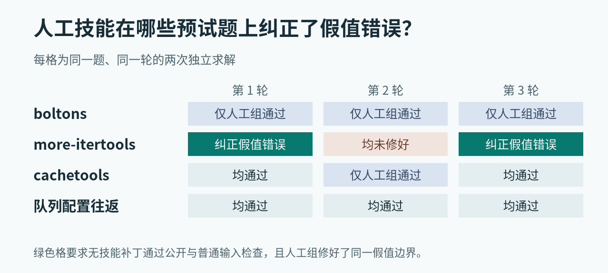
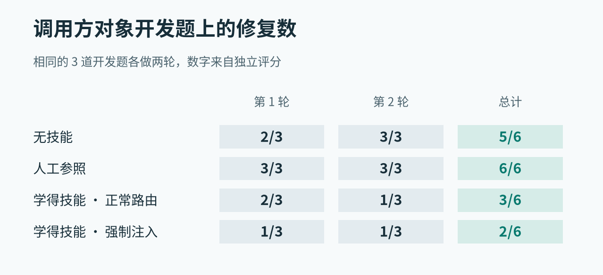

# 无技能模型会在哪个假值边界反复犯错？

这轮实验固定 GLM-5.3 和上一轮从四条学习轨迹生成的根技能。先检验人工参照技能能否纠正同一个具体错误，再检验模型自己写的技能能否在新任务中达到相同效果。两组实验均由模型在隔离的 Docker 工作区内编写补丁，独立评分器只在提交后装入隐藏检查。[原始学习记录](results/optional-control.json) · [预试与开发协议](../benchmarks/falsy_transfer/protocol.json)

## 四道独立预试

| 案例 | 故障与来源 |
| --- | --- |
| boltons 缓存缺项 | LRI、LRU 的缺项处理器可以是逻辑值为假的可调用对象。比较两种淘汰策略的实际调用与计数。[上游修复](https://github.com/mahmoud/boltons/commit/8408ab57e6c92b4ddd37db6220628ea41ee8bb5b) |
| more-itertools 单元素检查 | 当调用者提供自定义异常时，组装默认错误消息可能先触发元素的 `repr`。还要保留逻辑值为假的异常实例，分别检查空输入和过多输入。[上游修复](https://github.com/more-itertools/more-itertools/commit/def2dabea858b6ecb84ee0c52e6e07929f2c409c) |
| cachetools 容量计量 | 携带状态的大小计算器在长度为零时仍可调用。检查基础缓存与派生缓存的计量。[上游修复](https://github.com/tkem/cachetools/commit/ffe21c44d3f7de9c7a89870c8cf1fd7aa583a2ae) |
| 队列配置往返 | 独立编写的业务案例。缺省突发限额应回退到预设，显式的零应在预演、写入任务包和恢复后保留。[任务定义](../scripts/falsy_transfer_cases.py) |

前三题使用各自修复提交的父版本，只装入运行这个 API 所需的模块。问题描述、公开复现与隐藏检查由本项目编写。参考修复用于校准评分器。三道上游题的缺陷版本均未通过公开复现，固定的上游修复均通过全部检查。boltons 的上游提交还包含其他修改，评分范围仅覆盖可调用的缺项处理器。公开历史代码可能已经出现在模型的训练资料中。

每题三轮，每轮都有无技能组和强制注入人工技能组。两组拿到相同仓库、题面和 15 个求解动作名额。每轮交错运行顺序。人工技能只描述如何识别缺失值、跟踪调用方对象及检查其他入口，全文与数据划分一起冻结。模型看不到参考补丁、隐藏断言、所属分区或其他运行的解答。

预试判定要求**同一道题的同一个具名假值检查**在至少两轮满足下列条件。无技能组交付了补丁，公开测试和常规对照都通过，只有独立的假值检查揭示仍然存在的错误。对应的人工技能组通过包括该检查的完整评分。一次预算耗尽、一个单独通过的人工补丁、分散在不同题或不同检查上的胜例，都不能计入这个指标。[判定代码](../scripts/falsy_transfer_protocol.py)

## 预试结果

| 任务，每题三轮 | 无技能修好 | 人工技能修好 | 同一个假值检查得到纠正 |
| --- | ---: | ---: | ---: |
| boltons 缓存缺项 | 0/3 | 3/3 | 0/3 |
| more-itertools 单元素检查 | 0/3 | 2/3 | 2/3 |
| cachetools 容量计量 | 2/3 | 3/3 | 0/3 |
| 队列配置往返 | 3/3 | 3/3 | 0/3 |
| **合计** | **5/12** | **11/12** | **2 个配对** |

more-itertools 的三个无技能补丁都通过了公开复现和普通输入检查，也都在空序列上丢弃了调用者提供的假值异常实例。第一轮的补丁保护了错误消息的格式化，第三轮已处理过多元素分支，两者都漏掉了空序列分支。人工组第一、三轮交付的补丁保留了原异常对象，第二轮耗尽了动作预算。其他四个仅人工组通过的配对里，无技能组均未在步数内提交补丁。[逐轮动作与补丁复验记录](results/falsy-transfer.json)



## 新开发题与发布条件

第一批是四个独立编写的配置应用，分别处理仪表采样间隔、CSV 标题、打印单双面和绘图调色板。每题两轮，比较无技能、固定人工技能和正常语义路由下的学得技能。三个组共用同一轮的无技能对照。模型自己写的技能就是原始实验中的版本，标识以 `4075c246` 开头。开发数据和人工参照均未用于改写它。正常路由单独占用一个模型步骤，三个组各有 15 步用于求解。

| 新配置开发对照 | 无技能 | 人工参照 | 学得技能，正常路由 |
| --- | ---: | ---: | ---: |
| 第一轮独立通过 | 2/4 | 2/4 | 2/4 |
| 第二轮独立通过 | 1/4 | 3/4 | 4/4 |
| 合计 | 3/8 | 5/8 | 6/8 |
| 相对同轮无技能的胜 / 负 | — | 3 / 1 | 3 / 0 |
| 通过补丁复验的假值纠正 | — | 3 | 3 |
| 模型调用，含路由 | 72 | 85 | 77 |

学得技能在仪表书签、CSV 标题和调色板三个配对上把未通过的修复变为通过，三个胜例都在第二轮。仪表和调色板有同轮人工修复支持，CSV 标题只有学得技能组通过。两轮都选用了技能，路由跳过无法解释这批运行的轮间差异。相同四题的观测修复率差为 **+37.5 个百分点**。四道原始支持题两臂均通过。开发集无退化，也没有来源组满足两轮重复改善。第一批门禁拒绝了发布。[逐轮收据](results/falsy-transfer.json)

预试中的可重复错误来自调用方提供的对象。针对这个现象，另行登记了三个新开发契约，涉及记录索引的异常对象、批次标签的可调用策略、首次输出时为空的结果容器。补充组在第一批开发仍在运行时登记。设计知晓预试观察，所有补充题、评分和决策规则均在补充组首个模型调用前冻结。只有第一批开发门禁拒绝、且对象预试出现重复纠正时才启动。增加的第四组强制注入**同一份学得技能**，用于区分正常路由和强制注入下的表现。发布仍使用正常路由。[补充协议](../benchmarks/falsy_transfer/object-panel.json) · [新开发题](../scripts/falsy_object_cases.py)

| 对象题，每题两轮 | 无技能 | 人工参照 | 学得技能，正常路由 | 同一学得技能，强制注入 |
| --- | ---: | ---: | ---: | ---: |
| 记录索引的异常实例 | 2/2 | 2/2 | 2/2 | 0/2 |
| 批次标签的可调用策略 | 1/2 | 2/2 | 0/2 | 0/2 |
| 初始为空的输出容器 | 2/2 | 2/2 | 1/2 | 2/2 |
| **合计** | **5/6** | **6/6** | **3/6** | **2/6** |
| 实际注入技能 | 0/6 | 6/6 | 0/6 | 6/6 |
| 模型调用，含路由 | 50 | 55 | 51 | 47 |

在批次标签首轮，无技能补丁通过了公开和常规测试，却在空批次与非空批次都丢了调用方提供的可调用对象。人工组纠正了两个边界。原学得技能的适用条件集中在配置适配器和常量预设。在对象题上，正常路由明确跳过四次，返回不确定一次，另一次因路由响应不符合格式而跳过。六个配对的首次求解请求哈希均与无技能组相同，其中两个配对的最终评分仍然不同。两次分差不能归因于注入的技能内容。强制注入后，六次中有两次修好，在这批题上没有复现人工参照的收益。[逐轮证据、输入哈希和组合判定](results/falsy-objects.json)



正式门禁保留同一任务两轮重复改善、至少两个独立来源组、零观察到的退化、零基础设施错误以及学习证据回放。补充组需要在新增来源组上独立通过，还须与第一批开发记录、原四道支持题合并后再次通过。第一批的逐轮成绩按原运行 ID 复用。任何前期退化都会保留。新题没有借用预试的上游源码或测试。

留出沿用最初冻结的 30 道题。只有实际发布后，程序才允许模型接触这些题。每增加一族纳入 10 个新配对，按固定顺序混合单值覆盖、多层优先级和批处理。曲线纵轴是该混合中学得技能相对无技能的配对修复率差，同时标出新增任务族单独的差值。这三个点共用已纳入的样本，只能描述这个固定组合。

这次合并判定中，两轮重复改善的来源组仍为 0，正常路由臂在标签策略和结果容器上各出现一次单轮退化。运行库没有激活候选。两个状态库和共用账本均核对到留出求解 0 次、暴露 0 题。因此没有观测到收益曲线上的任何一个点。

后续实验为调用方对象新建了六道独立学习题。模型从一次借入租约的实际漏修生成子版，并为同题的两个真实补丁写出了可执行的行为检查。[后续技能修订实验](object-revision-study.md)

预试、第一批开发与支持回放合计 591 次 GLM 调用，估算 652.69577 套餐积分。对象题补充对照为 203 次，估算 165.93319 积分。两批合计 **794 次调用，818.62896 积分**，本次新增待结算预留为 0。原始补丁复验、旧门禁成绩复用和公开结果复算均不调用模型。

## 怎样复核

公开记录包含版本、配对顺序、路由、补丁哈希、逐项复验、独立评分，以及每次修复运行的模型调用次数和估算积分。仓库内可以不使用模型密钥复算。原始 SQLite 归档保存在本地。使用 `export` 时，审计器会从原始归档取出实际提交的补丁，在冻结镜像中重新执行每个不同的补丁与题目组合的边界断言，同时核对账本与留出题的暴露记录。

```bash
uv run --locked python scripts/report_falsy_transfer.py verify
uv run --locked python scripts/report_falsy_objects.py verify
uv run --script docs/results/plot.py
```

安装 Docker 并准备好 `python:3.12-slim` 后，以下命令可直接核对全部 11 道预试和新开发题。它们用原始缺陷版与参考修复分别执行公开复现、常规对照和逐项假值检查。首次运行可按固定提交下载三个上游项目，无需私有轨迹或模型密钥。

```bash
uv run --locked python scripts/report_falsy_transfer.py calibrate
uv run --locked python scripts/report_falsy_objects.py calibrate
```

真实复现实验需要首次学习所得根技能及其原学习归档、固定镜像和共用的 GLM 账本。状态目录须属于该次登记。中断续跑使用同一目录和原有运行记录。三个上游快照可从本机 Git 缓存或按提交下载。

```bash
uv run --locked python scripts/run_falsy_transfer.py prepare --root experiments/transfer-replication
uv run --locked python scripts/run_falsy_transfer.py run --root experiments/transfer-replication
uv run --locked python scripts/run_falsy_objects.py prepare --root experiments/objects-replication --primary experiments/transfer-replication
uv run --locked python scripts/run_falsy_objects.py run --root experiments/objects-replication --primary experiments/transfer-replication
```
