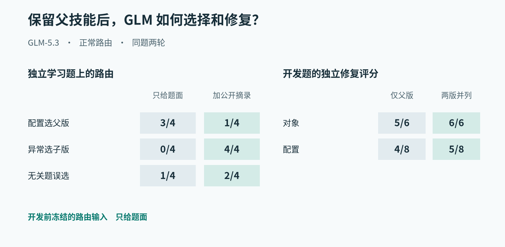

# 保留父技能，GLM 能自己选对版本吗？

上一轮强制使用对象子版时，三道对象开发题连续两轮全部修好。换成正常路由，对象子版在八次配置求解中都没被选用，在两次异常对象求解中也被跳过。本轮把两个不可变的技能同时列给 GLM，每次只选一个版本，或者跳过。配置父版来自最早的学习轨迹。对象子版来自借入租约在延迟重投时被丢弃的真实补丁，以及 GLM 自己写出的区分断言。[上轮修订与证据](object-revision-study.md) · [本轮预登记](../benchmarks/falsy_transfer/parallel-routing.json)

## 上一次的十个漏选是怎么发生的

- **配置题的八次漏选都是有效的语义跳过。** 当时库中只提供对象子版。采样间隔和导出标题的题面要求恢复缺省设置，路由回复指出题面没有交代调用方传入的假值遭到真值判断丢弃。打印配置与绘图配置出现了 null，数次回复援引了子版中关于缺键与显式 null 的排除条件。父版独有的“恢复约定预设”条件当时没有进入候选库。
- **异常对象题有两种原因。** 第一轮模型的结构化返回缺少必填的 `task_quotes`，执行器记录 `skip_invalid` 并继续无技能求解。第二轮模型作出了有效的跳过决定，理由是题面提到了调用方选择的异常，但未说明有效的假值异常如何被替换。项目给这两轮分别保留了校验错误和路由理由。[原始运行对应的分类记录](results/parallel-routing.json)

## 六道独立学习题检验了哪些解释

我们另建了六个可运行的 Python 工作区。窑炉驻留时间与字幕边距用于检验配置父版，货运拒单与预订失败用于检验调用方异常对象子版，字幕编号与空白显示名用于检验是否应该跳过。源码组独立于两个原开发面板、祖先支持集和留出集。六个缺陷版本与参考修复均已在同一 Docker 镜像中校准。这些任务是为机制诊断编写的独立实例。[任务源码与参考修复](../scripts/portfolio_route_cases.py)

每题分别给父版、子版、两个版本并列三种候选库。在每种库上，用原始题面和“题面加公开摘录”各做两次 GLM 调用，共 72 次。摘录来自公开 README 和至多三个可编辑文件，每个文件最多 1,200 字节。路由器只得到候选的适用条件和排除条件。它看不到任务分组、预期选项、修复步骤、成绩或评分器。两次重复保持同一请求哈希，每个候选库内按产物哈希固定排列。模型要引用题面或可见摘录中的原文。[路由输入和引用检查](../src/evocoder/routing.py)

| 两版并列，按预登记目标判定路由 | 只给题面 | 加公开文档和源码 |
| --- | ---: | ---: |
| 配置题正确选中父版 | 3/4 | 1/4 |
| 异常对象题正确选中子版 | 0/4 | 4/4 |
| 无关题误选任一技能 | 1/4 | 2/4 |
| 无效返回（全部 12 次选择） | 0/12 | 1/12 |

只给子版时，异常对象题的四次题面路由全部跳过或表示不确定。补充公开证据后，四次都选中了子版。只有父版可选时，这四次带摘录的异常题依然全部跳过。只给父版时，四次配置题面路由都选中父版。两个版本同时可选时，摘录也可能把配置题引向子版，例如 GLM 两次都在字幕边距题选了对象子版。它甚至在一次纯粹的编号题把 `max(1, i)` 误判为调用方覆盖值遭到丢弃。[72 条模型决策与引用](results/parallel-routing.json)

先登记的选择规则要求新增证据提高两类正例合计的正确数，同时保住各自的正确数，且无关题误选和无效返回都不增加。公开摘录在异常对象上带来四次正确选择，却同时损害配置与无关题。因此正式回打使用**只给题面**的正常路由。判断标签只用于学习阶段比较路由行为。“配置选子版”在此是偏离预定分工，补丁正确性由开发阶段单独评分。公开文档和源码同时加入，二者各自的作用仍待单独检验。

## 怎样判定可发布

三个对象来源和四个配置来源各做两轮，每道题的第二轮反转组别顺序。同轮重跑无技能、仅配置父版、父子并列三组。两组路由都调用一次同一 GLM-5.3，每组都给求解器 15 个动作。八道祖先学习证据再做一次三组配对回放。各组使用同一初始源码、镜像与独立评分器，记录实际注入的技能 ID、首次求解请求哈希、补丁哈希和每一项边界检查。

门禁要求至少两个独立对象来源在两轮中都出现“父版组失败、并列组实际使用子版且修好”。与原父版逐对比较，对象、配置和学习支持都要求零退化，同时保留与当前部署基线（无技能）的全库门禁。全部达到才发布包含两版的库，解封原来的 30 题，按单值、多层与批处理三个配置任务族测量配对收益。两项开发面板均被多次观察；独立学习题上的路由选择和开发题上的修复分别计数。[冻结的回打与发布实现](../scripts/run_parallel_routing.py)

## 对象面板的两轮结果

父子并列在对象题上两轮各修好 **3/3**。标签回调和结果容器合计四次选择对象子版，异常对象两次主动跳过。仅给配置父版时，两轮分别修好 **2/3、3/3**。无技能两轮分别修好 **1/3、2/3**。

| 独立对象来源 | 仅父版，第 1 / 2 轮 | 父子并列，第 1 / 2 轮 | 并列组实际选择 |
| --- | --- | --- | --- |
| 异常对象 | 通过 / 通过 | 通过 / 通过 | 跳过 / 跳过 |
| 标签回调 | 失败 / 通过 | 通过 / 通过 | 子版 / 子版 |
| 结果容器 | 通过 / 通过 | 通过 / 通过 | 子版 / 子版 |

标签回调的第一轮有可定位的补丁差异。父版组跳过技能，提交的补丁通过公开测试和常规输入，却在空批次与非空批次这两个边界都丢掉了假值回调。并列组实际注入子版，交付的补丁通过了两条边界断言。第二轮父版组也修好该题。结果容器两轮都用了子版，但父版组两轮也都通过。异常对象在并列组两轮均跳过技能并通过。**本轮当次父版只有一次失分，没有一个独立对象来源在两轮都有可挽回的失败。** 两版并列的 6/6 是可复验的面板成绩，符合两轮配对改善的来源数为 0。[逐次选择、补丁哈希与复验成绩](results/parallel-routing.json)

## 配置父技能保住了什么

前次只提供对象子版时，八次配置求解均跳过。本轮父子并列时，八次都选择了原配置父版。针对同一轮、同一题的比较如下。表中的分母是求解次数，每题每组各跑两次。

| 原开发面板 | 无技能 | 仅配置父版 | 父子并列 |
| --- | ---: | ---: | ---: |
| 调用方对象，三题 | 3/6 | 5/6 | **6/6** |
| 配置，四题 | 3/8 | 4/8 | **5/8** |
| 配置题中实际注入父技能 | 0/8 | 7/8 | **8/8** |

配置题的总通过数上升了一次，但零退化要求逐一检查配对。调色板第 1 轮、采样间隔第 2 轮是并列组独有的成功。导出标题第 2 轮则是仅父版组独有的成功。后者两个补丁都通过公开测试、常规输入和直接传入空标题的检查，只有仅父版组在重新载入保存的列定义后也保留了空标题。这三个不同结果的配对实际上都选中了同一个父技能，发给求解器的首次请求哈希也完全相同。它们计入发布风险，无法归因为技能选择的变化。[配对请求、独立边界评分与提交补丁哈希](results/parallel-routing.json)



八道祖先学习题的支持回放中，父版组与并列组都通过 **8/8**，无技能为 **7/8**。并列组在四道配置支持题选用父版，在四道对象支持题选用子版。相对当前部署的无技能基线，整库门禁也没有发现两个连续两轮改善且实际使用新子版的独立来源。两版并列的候选库未发布，30 道留出题的模型运行与接触数均为 **0**。多样性收益曲线保持待测。

本轮共使用 **635 次真实 GLM-5.3 调用**，包括 72 次专门的学习题路由诊断，以及 66 次开发或支持集求解中的 563 次路由与求解动作调用。套餐积分估算 **567.43501**，待结算预留与传输重试均为零。开发对照只覆盖三个已观察的对象来源，结果用于解释当前路由行为；新的对象来源仍需要独立检验。[逐运行账目与门禁](results/parallel-routing.json)

## 如何复核

公开 JSON 提供了 72 条学习题路由、逐题开发与支持回放、配对门禁、独立边界评分和套餐积分估算。每次调用在本实验内按账本顺序编号，可核对 72 次路由诊断均发生在第一次开发求解之前。原始会话、密钥和账本保存在运行环境。预登记在首个学习题模型调用之前公开，面板执行器在首个开发调用之前公开。[预登记提交](https://github.com/Phoenix-chaser/EvoCoder/commit/82bbe74) · [面板执行器提交](https://github.com/Phoenix-chaser/EvoCoder/commit/07d28c6)

在仓库根目录运行以下命令。第一条从公开记录复算结果，无需密钥或 Docker。第二条使用 Docker，在固定镜像中重现六道学习题的原始缺陷与参考修复。第三条从同一 JSON 重绘中英文图。

```bash
uv run --locked python scripts/report_parallel_routing.py verify
uv run --locked python scripts/report_parallel_routing.py calibrate
uv run --script docs/results/plot.py
```

从私有归档导出公开数据时，校验工具会逐条核对真实模型响应、实际注入的技能、首次求解请求和补丁哈希，在干净容器中重新评分带命名边界检查的 **48 个不同任务与补丁组合**，再核对模型接触的留出题和实际账本。重新调用真实模型可能交付不同补丁。[核验与重放代码](../scripts/report_parallel_routing.py)
