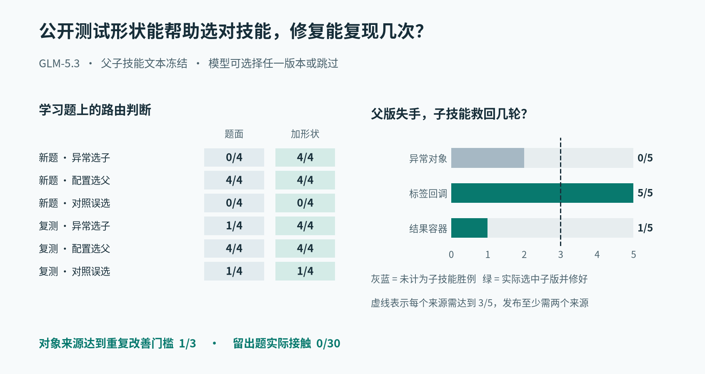

# 公开测试的形状能帮助 GLM 选对技能吗？

本实验检验两个问题。第一，在题面之外增加公开测试的结构，能否让 GLM 识别调用方提供的对象，同时保留原来处理配置的能力？第二，即便选对技能，提交的补丁能否在同一个来源的多轮独立求解中多次修好父版漏掉的行为？两项测量分别有路由判断和独立执行的测试作依据。[冻结协议](../benchmarks/falsy_transfer/shape-routing.json) · [逐次选择、评分与账目](results/shape-routing.json)

## 模型选择时能看到什么

原配置父技能由 GLM 从修复历史中归纳。调用方对象子技能由同一模型结合真实失败与同题成功补丁、模型自写断言及其执行结果修订。本轮冻结这两个技能内容。GLM 的正常路由每次可以选父版、选子版或跳过。父子产物的完整哈希见协议。[从失败补丁到子技能](object-revision-study.md)

路由器先读取题面，可选的 `public_shape` 再对公开测试文件做静态语法分析。例如 `assert Is: call:failure_of / name:expected` 表示测试要求返回调用方提供的同一实例；`assert Eq: attribute / int` 表示测试比较属性与整数。前者可以支持对象保留技能，后者应结合具体题面判断。每次最多取三个公开测试文件，提取文件名、符号名、调用参数的类型和断言关系。字符串值、注释、实现正文与隐藏测试内容都不进入这个视图。名字出现只能说明测试中有相应符号，不能证明该路径运行过。[形状提取](../src/evocoder/route_shape.py) · [模型输入和引用校验](../src/evocoder/routing.py)

GLM 只看各版本的适用条件与排除条件，用公开输入中的原文支持选择。运行器校验引用，随后才把所选技能的完整步骤交给求解器。这里同时引入了结构化信息和帮助解释结构的路由提示。题面和结构化并列两组共享完全相同的技能，可以测量这项组合改动的效果；各条信号的单独作用尚未测量。

## 先在学习题验证路由

六道旧学习题曾用于诊断上一版公开源码摘录的副作用。本轮另建六个来源独立的可执行学习程序，各有两道配置、两道异常对象、两道无关对照。其中的业务包括剧场预设灯光、照片校样标记、播放拒绝异常和货箱检验。独立 Docker 容器验证了每道新题的原始版本在公开用例和目标边界上失败、在常规输入上通过，参考补丁通过全部检查。这些程序为本研究设计。这里测到的是合成任务上的真实模型行为。[新学习任务及参考补丁](../scripts/shape_learning_cases.py)

每道学习题各用题面和结构化视图正常路由两次，共 48 次真实调用。表格的每格分母为四次判断，即两道题各两轮。两个视图的技能、模型和每个题目的可见信息在重复之间都被冻结。

| 学习来源 | 判断 | 同轮仅题面 | 同轮加测试形状 |
| --- | --- | ---: | ---: |
| 新建 | 异常对象选子版 | 0/4 | **4/4** |
| 新建 | 配置选父版 | 4/4 | **4/4** |
| 新建 | 无关题误选 | 0/4 | 0/4 |
| 复测 | 异常对象选子版 | 1/4 | **4/4** |
| 复测 | 配置选父版 | 4/4 | **4/4** |
| 复测 | 无关题误选 | 1/4 | 1/4 |

两批在两个视图下合计 48 次判断，格式或引用无效的次数为 0。旧批次的误选都落在空显示名对照题上。仅题面第一轮误选子版，结构化第二轮误选父版。事前只登记了一个结构化候选，两个学习批次均达到预定路由目标，随后使用相同策略进入开发。[路由协议与选择次序](../scripts/shape_study.py)

八次结构化异常路由还有一个共同点。GLM 每次都在依据中引用了 `__bool__` 或 `__len__`。四道异常学习题的公开文件都声明了这类自定义异常，但实际公开断言传入的是常规异常，未直接构造这些带方法的测试替身。原索引异常开发题检查的是同一异常实例，公开文件里只有处理显示失败的 `__repr__`。学习题的 4/4 具有明确的适用边界；这些记录无法单独区分身份断言和方法名对选择各贡献了多少。[逐次引用](results/shape-routing.json) · [原始开发任务](../scripts/falsy_object_cases.py)

## 怎样比较五轮修复

三个调用方对象来源、四个配置来源各做五轮。每轮都从同一个干净任务快照重新开始四次独立求解。四组是无技能、仅给原配置父版、仅题面加父子库、题面与公开测试形状加同一父子库。前三组各自提供当前部署基线、祖先技能基线和路由改动的直接对照。四组在前四轮轮换先后，第四组与第三组相比只改变路由可见信息及解释提示。三道对象题和四道配置题均为此前观察过的开发面板。

四组使用同一 GLM-5.3 请求配置，温度为 1.0，推理强度为 low。每组的求解器最多 15 个模型动作，有技能可选的组另有一次路由调用。直接传给求解器的首次请求取完整请求体哈希，最终补丁在固定镜像中独立评分。八道祖先学习支持题各做三轮，只比较无技能、仅父版、结构化父子库。这给出 140 次开发求解、72 次支持求解。平局、跳过、耗尽动作预算及相同请求得到不同结果的配对，全部保留。[四组求解、门禁与授权](../scripts/run_shape_routing.py)

每个对象来源的分母固定为五。某一轮要计为子技能胜例，须满足父版组失败、候选组实际注入子技能、首次求解请求发生变化，且候选补丁通过整题。每个来源至少三轮达到条件，至少两个独立对象来源达标。同时以原父版和当前部署的无技能为基线，对每个开发和支持任务逐一检查以下两条保护。

- **输入改变的净损失为零容忍。** 仅比较首次求解请求改变的配对，任何一题的负轮数超过胜轮数，就挡住发布。
- **原始多数退化也会挡住发布。** 将相同首次请求的胜负也算回去，开发题至少 3/5 轮、支持题至少 2/3 轮发生“原基线通过、候选失败”时触发。相同首次请求的胜和负都不记为技能效果，原始事实仍列在报告中。

相同首次请求只能说明两次求解起点相同，后续的模型输出、动作与测试反馈仍可能分叉。五轮都使用同一服务，轮次也不等同于五个独立项目。这是预登记的工程发布规则，不能据此给出总体无退化或统计显著性的保证。[固定分母与逐题判定](../src/evocoder/repeat_gate.py)

## 哪个对象来源真正重复改善

| 五轮配对的来源 | 仅父版修好 | 同库仅题面修好 | 同库加形状修好 | 加形状选中子版 | 满足归因规则的胜轮，相对仅父版 |
| --- | ---: | ---: | ---: | ---: | ---: |
| 标签回调 | 0/5 | 3/5 | **5/5** | 5/5 | **5/5** |
| 结果容器 | 4/5 | 5/5 | **5/5** | 5/5 | 1/5 |
| 索引异常 | 3/5 | 0/5 | 2/5 | 0/5 | 0/5 |

标签回调是本轮可以逐次核验的技能收益。五次仅父版求解全部跳过技能，五个提交都通过公开测试，但全都在空批次上丢掉调用方的假值回调，其中四个也在非空批次失败。结构化并列组五次选用同一个已修订子技能，五个补丁都通过公开测试、常规输入及两个批次边界。相比之下，结果容器上父版本来就修对了四次，子版五次都选中且都修对，最多只能多修好一次。[逐运行的实际路由和命名边界检查](results/shape-routing.json)

索引异常上，两个并列组十次均跳过技能。部分路由解释把题面中的问题归为键显示和异常传递，认为公开测试未显示真假值处理。即使两组五对首次求解请求全部相同，仅题面修好 0/5，加形状修好 2/5。仅父版说的是可用技能库；它在这一题也五次跳过，修好 3/5。五轮里父版本身只失手两次，已经小于三次胜轮的门槛。

保持两个技能不变，整个对象面板从仅题面的 **8/15** 到加形状的 **12/15**，四个新增成功中只有标签回调第二轮从跳过变成使用子版。另三对的首次求解请求相同，包括异常题的两对和标签回调的一对。相对父技能的可复现收益、结构化路由本身的增量、求解随机性因此有了各自可查的证据。



## 原配置能力是否保住

| 开发面板，五轮 | 无技能 | 仅配置父版 | 父子库，仅题面 | 同一父子库，加形状 |
| --- | ---: | ---: | ---: | ---: |
| 调用方对象，3 题 | 8/15 | 7/15 | 8/15 | **12/15** |
| 原配置，4 题 | 9/20 | **18/20** | 15/20 | 11/20 |
| 配置题实际注入父技能 | 0/20 | 20/20 | 20/20 | 17/20 |

三次配置题选中对象子版均发生在打印工单，三个配对的两个补丁都通过全部检查。与仅父版相比，原配置面板共出现零胜、七负、十三平。七次损失的两组都实际使用同一父技能，首次求解请求完全相同。和同库仅题面相比，加形状的配置配对出现一胜、五负、十四平，六个分歧的首次求解请求也都相同。这里无法把配置分差归因为新增形状或错误选中子版。

配置的实际风险仍可从补丁上定位。导出列标题题中，仅父版通过 4/5，结构化并列组 0/5，四次配对损失都没能在重新载入列定义后保留空标题，其中两次还丢失直接传入的空标题。采样间隔和调色板另外贡献一次、两次损失。导出列题触发每题至少三次原始负轮即拒绝的保护。**学习题上保持配置选父版 4/4，并未保证开发配置题的路由和修复率都能保持。** [逐题探针与首次求解请求](results/shape-routing.json)

## 支持回放、发布与账目

140 次开发求解均按原登记完成。八道祖先学习题计划跑三轮、每轮三组，共 72 个原始求解。第三轮执行进程被终止。一个求解已经提交补丁并完成公开测试，评测器从已存补丁恢复独立评分。另三个求解在等待服务端回复时中断，原始成绩记为缺失。我们在发出后续调用前公开了恢复规则，继续完成尚未开始的原始求解，并为每个缺口单独运行一次相同设置的描述性补测，保留原始请求、所有费用和两种统计口径。[中断与恢复规则提交](https://github.com/Phoenix-chaser/EvoCoder/commit/c698480) · [冻结的四个受影响执行记录](../benchmarks/falsy_transfer/shape-routing-interruption.json)

| 学习支持，原计划各组 24 次 | 无技能 | 仅父版 | 同库加形状 |
| --- | ---: | ---: | ---: |
| 原始求解通过数 / 有原始成绩数 | 21/22 | 21/24 | 23/23 |
| 缺失的原始成绩 | 2 | 0 | 1 |
| 独立补测通过数 / 补测数 | 2/2 | — | 1/1 |

补测不能填补正式发布所需的原始证据。完整开发面板已独立给出拒绝理由。对象的三个来源中只有标签回调达到至少三次配对胜利；即使把另两个来源的每次父版失败都救回来，也各只有两次和一次机会。原配置列标题还触发原始多数退化保护。候选库未发布，按模型运行库与接触账本核对，原 30 道留出题的模型接触数为 **0**。收益随任务族多样性的曲线仍待测。

本轮账本登记 **2,002 笔真实 GLM 调用尝试**。其中 1,999 笔有响应且已结算，套餐积分本地估算为 **1,971.88846**。另三笔缺少服务端返回的用量，**79.1442 积分**仍是本地预留。两项分别列账，保留这三笔的未知状态。离线编码重建了 **61 种不同的完整路由请求体**，与实际 202 次路由调用的哈希逐一匹配。独立容器重新评分了 **135 个不同的任务与补丁组合**。其中 124 个带命名边界探针，其余 11 个重跑原公开测试和独立合同评分器。[逐次账目、原始与补测映射、发布收据](results/shape-routing.json)

## 如何复核

预登记已在首个学习诊断调用前公开，四组开发执行器已在首个开发求解前公开。两组学习题的路由、完整配对、补丁摘要和本实验内的调用顺序写入公开 JSON。评测在私有运行归档上逐条核对 GLM 响应与实际注入的技能，再从独立容器重放已提交的不同补丁。读者可离线用相同的编码器、公开题目和两份冻结技能重新生成每种路由请求，并对照真实请求哈希。核对分数与门禁也无需访问模型供应商。[预登记提交](https://github.com/Phoenix-chaser/EvoCoder/commit/688f1c5) · [执行器提交](https://github.com/Phoenix-chaser/EvoCoder/commit/a6f5b3c) · [审计与复算程序](../scripts/report_shape_routing.py)

在仓库根目录运行以下命令，分别复算公开记录、用 Docker 重放六道新题的故障与参考修复、重绘中英文图表。前两条命令均不使用模型额度；第一条也无需 Docker。

```bash
uv run --locked python scripts/report_shape_routing.py verify
uv run --locked python scripts/report_shape_routing.py calibrate
uv run --script docs/results/plot.py
```
