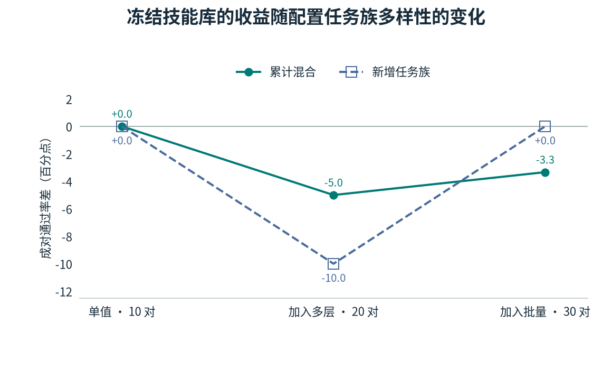

# GLM 对象技能如何从失败中修订、通过发布门禁并接受留出测量

EvoCoder 使用固定的 GLM-5.3、同一套工具和 Docker 镜像。模型能修改的是以后交给路由器的技能适用条件，以及选中后交给求解器的修复步骤。每次求解最多有 15 次模型动作，有技能的组另用一次模型调用选技能。原来的配置技能始终是可选成员。[实验登记](../benchmarks/falsy_transfer/workflow-revision.json)

## 学习题怎样触发修订

学习输入是四个新编的可执行 Python 程序。两个要求保存、恢复调用方给定的布尔选项。另两个要求把调用方的检查器或电平表带到不同的消费者，在暂停后按原合同继续工作。初始阶段共 24 次真实求解。旧库在两道布尔题的八次正常路由中八次选了对象技能。多数补丁依然通过，因而单独计数路由误选和修复失败很重要。在工具栏题的一次提交中，显式关闭和保存后关闭都通过，常规输入失败。

调音台题的一次正常路由选中了旧对象技能。它的补丁通过公开测试，成功保存了假值电平表，但恢复采样和常规输入都失败。运行 `0789f41d` 的提交在 `wake` 中使用了 `next(iterator, studio.meter())`。Python 在进入 `next` 前就计算第二个实参，因此即使票据里已有电平表也会访问演播室。同一补丁在根据公开合同编写的独立检查中也失败。在另一个学习题中，没有提供检查器时，在新工作节点恢复应当读取该节点的默认检查器。学习记录分别标记这两条路径。为“仅默认值失败”预登记的补充学习批次没有启用，原方案已取得“调用方对象恢复失败”的证据。[独立任务和公开检查](../scripts/workflow_cases.py) · [补充学习的启动条件](../benchmarks/falsy_transfer/workflow-wake-replay.json)

GLM 首次修订引用了五次学习运行中的证据。生成器看到原技能、实际路由、提交补丁的独立验证结果、公开合同及独立公开检查。首次提示明确要求比较公开断言代表的值或实例，以及首次调用和稍后调用的行为。隐藏测试源码和预试、开发、留出题均未进入修订请求。程序根据同一次运行中的补丁和测试生成摘要，并为适用条件、步骤和验证等变化签发收据。第一份修订写入了恢复后的对象优先级，同时把合法假值对象和标量值写进了同一适用条件。这个分歧进入了后续的学习复核。

实际调用顺序是首次修订、仅父版预试、学习题候选复核、冻结正式对照。预试程序和评分记录没有交给候选或提案模型。在候选首次接触开发题之前，另行登记了学习阶段的选择规则。若首份修订在正常路由中仍误选布尔题，允许 GLM 基于真实学习记录生成一个同父候选。模型额外获得配置技能的公开职责，以及“值选项归配置技能或跳过，调用方对象归对象技能”的学习标签。这一步包含人工给定的职责监督。具体技能文字、检查步骤和排除条件由 GLM 生成。新候选须在相同的四道学习题上让布尔误选严格减少，并维持唤醒和总体通过数，才有资格替代首份候选。学习成绩用于选版本，开发成绩单独统计。[学习选择登记](../benchmarks/falsy_transfer/workflow-candidate-selection.json)

| 四道学习题，各两轮 | 布尔题误选对象技能 | 唤醒题整题通过 | 总通过 |
| --- | ---: | ---: | ---: |
| 第一份修订 | 4/4 | 3/4 | 7/8 |
| 加入职责监督的同父修订 | 1/4 | 2/4 | 6/8 |

职责监督让 GLM 写出了将标量值设置交给配置技能的排除条件。在港口程序的一次提交中（`51e28eab`），票据没有检查器时，仍然先取新工作节点显式配置的检查器，导致换站后的默认设备检查失败。在调音台的另一份提交中（`cc39b7f8`），模型把本次解析出的默认电平表写进票据，恢复时没有重新读取新演播室的默认值。两次都通过了公开用例以及恢复调用方自带假值对象的检查。三次较少的布尔误选伴随一次较少的唤醒修复，第二份候选没有满足学习选择规则。正式发布评测冻结第一份修订，覆盖 331 次新求解，两个重点对象来源各五轮，四项配置保护各七轮。[冻结版本、祖先支持清单及各题分组](../benchmarks/falsy_transfer/workflow-panel.json)

## 新来源如何取得对照资格

日志游标程序通过函数和元组保存进度监听器。复制水位程序用类保存延迟确认，并在新 broker 上送达。两套实现的工作区、公开测试、隐藏检查和参考补丁各自冻结。第一阶段只运行原配置父技能，使用原生路由。漏修计数仅包括已提交、公开测试和常规输入均通过，同时仍有一条调用方回调边界失败的补丁。两套实现各五次，都有 **3/5** 次达到这个定义。按登记次序选定第二套实现进入开发，备用的补偿事务来源没有启动。正式开发重新运行所有比较臂，预试的十次运行不计入胜轮。这个来源经过父版难度筛选，后续胜轮描述它在固定题目上的重复表现。[来源定义和冻结的评分校准](../benchmarks/falsy_transfer/workflow-revision.json)

## 门禁和留出集

原标签回调和新水位回调各跑五轮。每个来源都须分别相对无技能、仅配置父技能有至少三个胜轮，并且新库实际选中了修订后的对象技能，首次求解请求也确实发生了变化。另有四个此前观察过的对象程序，各跑五轮。四个原配置程序各跑七轮，完整祖先学习证据集每题回放三轮，历史调度器回放五轮。打印配置和唤醒程序与同轮原父子库直接比较。仅配置父技能的路由器沿用原来的问题描述输入，旧库和修订库则都看到相同的公开测试形状。相对父技能的差异包含技能可选范围和路由信息的变化。要判断这次修订本身的增量，可以比较同轮旧库与新库，并查阅两边实际选用的技能。

配置保护沿用上轮预登记规则。逐题要求首次请求改变的净胜非负，并保留七次中六次原始负轮的拒绝线。七个轮次的面板合计使用预登记的单侧符号翻转检验。原始通过、相同请求的分歧、实际选中的技能、具名边界和未评分槽位都保留。首次请求哈希变化及选中技能是配对归因的操作性标准，仍有模型采样噪声。

只有 SQLite 中的正式通过收据才能激活冻结技能库。随后才可对原先的 30 个配置程序各执行一次无技能和一次已发布库求解，依次报告单值、多层、批处理三个累计混合点。这三个点共用前面已经纳入的样本。该留出集测量的是配置任务族的迁移，日志回调的对象迁移由开发对照单独描述。

## 五轮对象效果与首次发布收据

| 对象来源 | 无技能通过 | 仅配置父技能通过 | 旧父子库通过 | 修订库通过 | 修订库对父技能的归因胜轮 | 修订库对无技能的归因胜轮 |
| --- | ---: | ---: | ---: | ---: | ---: | ---: |
| 原标签回调 | 2/5 | 0/5 | 5/5 | 5/5 | 5/5 | 3/5 |
| 复制水位与延迟确认 | 0/5 | 1/5 | 4/5 | 5/5 | 4/5 | 5/5 |

两个预定来源均满足分别对两种基线至少三个归因胜轮的要求。与旧对象技能直接比较，水位回调第四轮出现一次新增修复，标签回调两版全部通过。调度器的旧库和修订库都在五次运行中通过了常规输入和唤醒重放。

首次正式门禁共安排 331 次求解，322 次取得成绩。第六轮配置比较中 GLM 的 TLS 连接中断，9 个槽位没有最终成绩。七个槽位正常评分，第七轮的 16 个槽位也完整取得成绩。首次正式收据为 `47d314fa3f7d7cdd3ff13b489d41fa4f94b18102a64925399ae656ce9b569829`。当时的数据库记录为拒绝，发布交易为零，留出题接触为零。[原始配对、独立重评分与拒绝收据](results/workflow-revision.json)

另行预登记的诊断补测重新执行了第六轮全部四道配置题、四个比较组，共 16 次，全部得到成绩。将这一块与其他六个完整原始配置块一起看，打印题的旧库在七次中六次选对象技能，新库四次。两组七次都通过了打印常规输入。相对配置父技能及无技能，四道题均通过两重退化保护。这批数据只用于诊断原先缺失的配置保护，保持第一次发布判定。[整轮补测登记](../benchmarks/falsy_transfer/workflow-config-recovery.json) · [诊断补测的全部结果](results/workflow-config-recovery.json)

## 独立的发布复核

在开始新复核的付费调用前，再次冻结同一候选。五轮对象配对、历史调度器和全部祖先支持数据完整保留，四个配置程序的四组比较从第一轮起全部重做。每次原始配置成绩和诊断补测成绩都保留在各自的收据中，新评测器只从新收集的七个完整配置块取数。若发生传输级缺测，预登记允许整块追加一次，所有已评分槽位也会一起重跑。分数或模型选择本身不会触发重跑。原配置可比较记录已经越过的逐题退化线仍然能够阻止发布。

这次复核独立重复的是配置保护。对象修复和调度器结果仍是前文同一批五轮观察。新部署从冻结的原技能数据库复制，共享原有 GLM 套餐账本与留出集接触记录。发布使用新的评测收据和真正的 SQLite 比较并交换事务。[新发布协议](../benchmarks/falsy_transfer/workflow-confirmation.json) · [候选、代码及复用证据的冻结哈希](../benchmarks/falsy_transfer/workflow-confirmation-lock.json)

七个新配置块全部在首次采集时完成，共 112/112 次有分数。无技能、仅配置父技能、旧父子库和修订库分别通过 **12/28、21/28、17/28、21/28**。各项配置的变更请求净胜与原始负轮保护均通过。配置整体不利方向的七块符号翻转概率，对父技能为 0.75，对无技能为 1.00。

打印配置题的常规输入，旧库通过 6/7，修订库通过 7/7。两边选错对象技能都是 4/7，这次正式复核没有复现诊断补测中的误选次数下降。调度器唤醒检查两边都是 5/5。修订版通过了保护，仍有可观测的布尔误选。

评测器写入通过收据 `08848c0472807707d565f07fa15d761d6d8c15bc6854f8af907dc17758a0edd2`，在新实验部署中把活跃库从空切换到 `42a17027f2ededa9bebbdcd21172be38d8255eaf8eed9725d3b6203b365e132e`。这是该部署的第 1 条发布交易。成员为原配置父技能与首份对象修订，模型仍然可以跳过。[数据库交易、七轮配置与发布后测量](results/workflow-confirmation.json)

## 发布后的 30 道留出题

评测器确认数据库中的活跃版本后，才将 30 道冻结的配置题送入两组真实 GLM 求解。每题每组一次，全程固定父子技能库，60 次求解均有成绩。每个任务族恰有 10 题，后一个累计点包含前一个点的全部题目。表和图均从相同的逐题配对生成。[配对、路由记录与激活交易](results/workflow-confirmation.json)

| 新加入的任务族 | 本族无技能通过 | 本族发布库通过 | 本族通过率差 | 累计题数 | 累计通过率差 |
| --- | ---: | ---: | ---: | ---: | ---: |
| 单值配置 | 10/10 | 10/10 | 0 | 10 | 0 |
| 多层配置 | 10/10 | 9/10 | −10.0 个百分点 | 20 | −5.0 个百分点 |
| 批量配置 | 10/10 | 10/10 | 0 | 30 | −3.3 个百分点 |



无技能组 30/30，发布库 29/30。29 对两组都修好，1 对只有无技能组修好。发布库 30 次都选了配置父技能，对象子技能在这个面板被选中 0 次。因此留出成绩描述整库向新配置任务的迁移。两项回调开发对照才观察到了修订子技能实际被调用后的结果。无技能组已达满分，每题每组又只有一个样本，三点曲线描述的是这一次测量。

唯一发生分歧的 `renderer-02` 要合并租户层和请求层的分页设置。无技能提交在合并每层前跳过 `None`。选了父技能的提交先逐层覆盖，最后再将 `None` 换为全局默认值。将两份原始提交分别在固定 Docker 镜像中重放，传入租户 `paginate=False`、请求 `paginate=None`，前者返回 `False`，后者返回 `True`。该输入展示了原样保留显式假值与继承上一层配置同时成立的情形。[通过组运行 `a9f52785` 与失败组运行 `0568268a` 所在的留出明细](results/workflow-confirmation.json)

三份本轮公开账目合计 **5,513 次 GLM 调用，已结算 6,386.41196 套餐积分**。其中，独立发布复核与留出测试合计 1,497 次调用、1,499.62687 积分。首轮账本另列 228.10725 积分的未结预留，这部分单独记录。[首次评测账目](results/workflow-revision.json) · [诊断补测账目](results/workflow-config-recovery.json) · [复核与留出账目](results/workflow-confirmation.json)

## 复核命令

在仓库根目录执行以下命令，可从公开数据重算学习选择、五轮归因胜轮、配置保护、计费与发布状态。均不需要模型密钥。最后两条使用本机已有的注册 Docker 镜像，分别重放四份学习补丁和留出题中唯一分歧的两份补丁。留出题回放同时检查两份提交的内容哈希、公开测试、独立评分和上面的租户继承示例。[两份留出提交](results/workflow-renderer-pair.json)

```bash
uv run --locked python scripts/report_workflow_revision.py verify
uv run --locked python scripts/workflow_config_recovery.py verify
uv run --locked python scripts/workflow_confirmation.py verify
uv run --locked python scripts/report_workflow_revision.py replay-examples
uv run --locked python scripts/replay_workflow_difference.py --execute
```

可用 `python3 scripts/plot_workflow_revision.py` 从这两份公开的评测结果重画中英文图表。绘图环境需要 Matplotlib，中文版使用 Noto Sans CJK SC 字体。[绘图脚本](../scripts/plot_workflow_revision.py)

公开记录保存运行标识、请求与补丁哈希、路由、分项评分、费用和文中举例的合成任务补丁。完整模型对话、账户账本和原始 SQLite 文件保存在本机。
